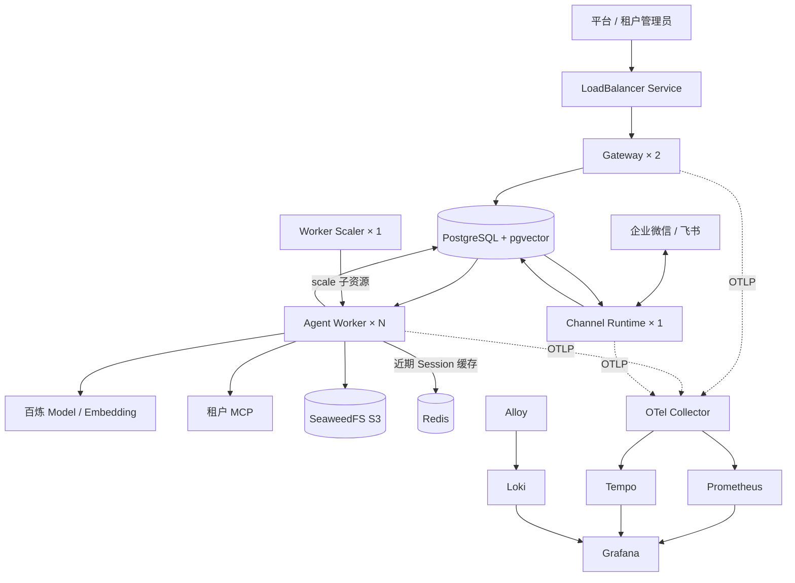

# Kubernetes 部署

## 定位

2026-10-16 在 Docker Desktop 的三节点 kind 集群重新部署、滚动更新并验证。集群为 Kubernetes v1.36.1，包含 1 个控制面和 2 个工作节点。本轮修订与实际结果见 [Kubernetes 验收记录](Kubernetes验收记录.md)。此前 Locust 容量测试运行在单台 WSL 主机，不能把其吞吐和延迟标为该集群的实测值。

清单包含 2 个 Gateway、1 个 IM Channel Runtime、1 个 Worker Scaler，以及共享存储和监控组件。Worker 数量由数据库中的期望值控制，新数据库默认为 2。资源位于 `trpc-agent-service` Namespace，Pod 由 Deployment/StatefulSet 创建。

脚本明确要求当前 kubectl context 为 `docker-desktop`，使用本机 Docker 镜像；它不是任意集群的通用部署命令。生产部署需另外调整镜像分发、存储、网络与凭据来源，并补充 TLS、备份和跨故障域调度。默认 `app.env` 使用 HTTP 和 `TRPC_SERVICE_SECURE_COOKIES=false`，仍是本地验收配置。



`Agent Worker × N` 的 N 来自数据库中的期望节点数，系统管理端修改后由 Scaler 收敛。Worker 清单不再填写 `spec.replicas`；部署脚本还会清除旧版 last-applied 注解中的副本字段，避免升级时把已设定的数量重置为 2 或 1。Gateway、Worker、Channel 和 Scaler 是独立 Deployment，业务事实都进入共享存储。Worker Pod 显式设置 `TRPC_SERVICE_WORKER_CONCURRENCY=1`，即每进程 1 个异步 slot；增加副本数与调整每个 Worker 的 slot 数是不同操作。

本地脚本模式和 Kubernetes 模式会使用相同的 8000、3000、9090 等本机端口，不能直接按默认配置同时运行。本地切到 Kubernetes 前执行 `./stop.sh`。反向切换时要注意：`./deploy/kubernetes/stop.sh` 只把应用副本缩为零，保留数据库、监控和 Service，不保证释放 LoadBalancer 的本机端口。先检查 `kubectl get services -n trpc-agent-service`，处理端口暴露冲突或调整本地端口与连接配置，再启动 Compose 模式。

## 部署

所有命令从项目根目录运行，需要 Docker CLI、kubectl、Python 3、OpenSSL 和 Bash。先确认 Docker Desktop 的 Kubernetes 已启用，`kubectl config current-context` 为 `docker-desktop`。脚本检查 API 后，将后续请求固定到该 context，避免执行途中切换 context 误操作其他集群。脚本只自动补建租户 SecretStore 主密钥；PostgreSQL 密码、Bootstrap Token、Grafana 密码必须已存在。

`.env` 中的 `TRPC_SERVICE_LLM` 和 `TRPC_SERVICE_EMBEDDING` 会覆盖 Kubernetes 模板中的模型设置；未填写时使用 `app.env` 默认值。API 凭据必须使用 `env://变量名` 引用，并在 `.env` 中配置对应值，通常为 `DASHSCOPE_API_KEY`。部署不会执行 `.env` 中的 Shell 内容，也不会把宿主机的 localhost 数据库、Redis、S3 地址复制进 Pod。

配置解析使用应用镜像中已锁定的依赖，不要求宿主机另外安装 dotenv 或 Pydantic。生成的临时文件仅当前用户可读，API Key 从文件写入 Kubernetes Secret，不出现在 kubectl 命令参数中；脚本退出时删除临时文件。不同模型可以引用不同环境凭据。

用过本地 `start.sh` 时沿用已有 `.secrets/`。全新部署可以按下面的方式补齐缺失文件，已有非空文件不会被覆盖：

```bash
umask 077
mkdir -p .secrets
for secret_name in postgres_password admin_bootstrap_token tenant_secret_master_key grafana_admin_password; do
    if [ ! -s ".secrets/$secret_name" ]; then
        openssl rand -hex 32 > ".secrets/$secret_name"
    fi
done
```

如果导入的是已有数据库，必须使用它原先的租户 SecretStore 主密钥；重新生成一个同名文件不能解密旧凭据。

首次部署且需要导入 Compose 的 PostgreSQL 数据时，先停止宿主机进程，再只启动源 PostgreSQL：

```bash
./stop.sh
docker compose up --detach --wait postgres
./deploy/kubernetes/deploy.sh --import-compose-data
docker compose down
```

`--import-compose-data` **仅迁移 PostgreSQL**，不会复制 SeaweedFS 对象、Redis 缓存或本地 Workspace 文件。若旧知识库仍引用 Compose 中的对象文件，需另行迁移对象存储或在 Kubernetes 租户控制台重新上传；不能把数据库导入成功视为知识库文件也已迁移。

导入使用 `pg_dump --clean --if-exists`，会在目标库先删除转储中对应的对象，再恢复源数据；它不是两套数据的合并。只对明确允许覆盖的目标环境使用，不要将该参数放进日常更新命令。

后续更新直接执行：

```bash
./deploy/kubernetes/deploy.sh
```

如果只修改了 Kubernetes 清单或运行配置，或者目标应用镜像已由 CI 构建，可以显式复用本机已有镜像，避免重复构建：

```bash
TRPC_K8S_REUSE_IMAGE='trpc-agent-service:your-existing-tag' ./deploy/kubernetes/deploy.sh
```

应用代码发生变化时仍应使用默认命令构建新镜像；复用模式会先验证镜像存在，再执行迁移和滚动发布。

脚本会使用项目 `Dockerfile` 构建 Python 3.12 应用镜像、同步平台 Secret、创建 ConfigMap、启动存储和监控、执行 Alembic Job，并滚动部署应用角色。每次重新部署都会重启依赖 ConfigMap 的可观测组件，并将 PostgreSQL、Grafana 持久化密码与最新 Secret 同步，避免 Pod 继续使用旧配置或旧密码。真实密钥只从已忽略的 `.env` 和 `.secrets/` 读取，不写入部署清单。PostgreSQL 只挂载数据库密码，Grafana 只挂载 Grafana 密码，不再把平台主密钥一起挂载给这两个组件。

默认保留旧应用镜像，方便排查和回滚。确需清理时可以设置 `TRPC_K8S_PRUNE_IMAGES=1`；清理会保留当前 Namespace 中 Pod、ReplicaSet 和 Job 引用的镜像。代码回滚不能撤销数据库迁移，也不能恢复已删除的数据。

新建或更新的 IM Binding 由租户管理员在 `/tenant` 中配置，密钥以数据库密文保存。部署脚本**不会**把旧的本地文件型 IM SecretRef 挂载进 Pod；如导入的旧 Binding 仍引用这类文件，部署后需在租户控制台重新保存密钥，使其转为数据库密文，否则对应 IM 长连接无法使用。

模型和 Embedding 配置从 `.env` 继承，不等于本地控制台的租户、Model Profile 和机器人配置也已迁移。部署前核对 Profile 引用的凭据在 Pod 内是否可用，Embedding 模型是否与知识库记录一致。当前向量列固定为 1024 维；仅更换模型名不会重建旧索引。全新集群使用独立数据库，需在控制台重新建立业务配置，或按前述条件明确执行数据导入。

数据库升级由 `database-migration` Job 统一执行，当前 head 为 `20260930_0029`。该版本增加删除清理收据等结构；修改应用副本数不会代替迁移，迁移失败时应先查看 Job 日志。

清单提供 Redis、PostgreSQL/pgvector、SeaweedFS 和监控组件。Skill、MCP 客户端随应用镜像运行，不为每个租户创建独立 Pod。部署成功后仍需验证模型额度、机器人权限、MCP 出站访问和知识文件可读性。

## 验证

```bash
kubectl get pods -n trpc-agent-service -o wide
kubectl get services -n trpc-agent-service
kubectl logs -n trpc-agent-service job/database-migration
curl --fail --max-time 5 http://localhost:8000/health
curl --fail --max-time 5 http://localhost:8000/ready
```

迁移 Job 完成后会按清单在 3,600 秒后清理，过期后无法再通过上面的命令读取日志。`/ready` 只查询主数据库并报告活跃 Worker 数，0 个 Worker 也可能返回 200。还需查看对应 Binding 的认证日志，并实际完成文本、RAG 与 MCP 请求；Pod Ready 不代表模型额度和外部权限已经验证。

Worker、Channel 和 Scaler 有独立的启动与就绪探针。进程成功登记或刷新数据库心跳后，在 Pod 的 `/tmp` 写入健康记录；探针检查角色、进程启动标识、状态和心跳新鲜度。Worker 进入排空后不再就绪，旧进程遗留的文件不能让新进程直接通过检查。这里没有使用依赖数据库的存活探针，避免数据库短暂中断时连带重启全部执行者。探针证明登记和心跳可用，不证明 Scaler 已完成副本对账，也不证明每个机器人或外部工具都正常。部署脚本另外等待数据库中活跃 Worker 数、Deployment 的更新/就绪/可用副本数都达到已保存的目标；零副本的 rollout 成功不会再被当作部署完成。

- 系统管理端：`http://localhost:8000/admin`
- 租户管理端：`http://localhost:8000/tenant`
- Grafana：`http://localhost:3000`
- Prometheus：`http://localhost:9090`
- Bootstrap Token 和 Grafana 密码继续读取 `.secrets/` 下的原文件；Grafana 用户名固定为 `admin`。

执行节点统一在系统管理端的“运行节点”页面调整。页面只写入期望数量，`worker-scaler` ServiceAccount 仅有读取和修改 `agent-worker` scale 子资源的权限，不能操作其他 Deployment。

Scaler 每轮对账重新读取挂载的 ServiceAccount Token，支持 kubelet 轮换令牌；不会长期使用进程启动时缓存的旧令牌。停止后，Scale API 可能返回 `spec: {}`，此时缺省副本数为 0。Scaler 按这个值恢复数据库中保留的目标数量。

紧急运维仍可临时执行：

```bash
kubectl scale deployment/agent-worker -n trpc-agent-service --replicas=3
```

Worker Scaler 会在下一次对账时恢复管理端保存的期望数量，因此不能长期同时使用手工 `kubectl scale`、HPA 和管理端期望值。后续接入 HPA 时，应将容量控制权切换给 HPA，而不是让两个控制器同时修改副本数。

Kubernetes 缩容时先向 Pod 发送 `SIGTERM`。Worker 立即进入 `draining` 并停止领取任务，`terminationGracePeriodSeconds` 为现有任务保留完成窗口；最终状态继续由任务租约和 fencing token 保护。

## 停止与清理

仅停止应用并保留全部数据：

```bash
./deploy/kubernetes/stop.sh
```

脚本先停止并等待 Scaler Pod 退出，再停止其余应用角色，并等待 Pod 删除。Worker 的等待上限为 240 秒，覆盖清单中的 210 秒终止宽限期。重新启动可以复用当前镜像执行部署脚本，数据库中的期望 Worker 数量保留。

删除 Namespace、组件和全部 Kubernetes PVC 测试数据：

```bash
./deploy/kubernetes/remove.sh --confirm-delete-data
```

本地 StorageClass 使用节点本地卷，不能据此承诺跨节点存储容灾。Worker 的 `/data/workspaces` 使用 Pod 独立 `emptyDir`。目录 ID 还包含当前执行 fence，接管使用新目录，不继承旧尝试的临时文件；改成 RWX 共享卷也不会改变这个语义。需要保留的结果必须写入 Artifact 或数据库。

Session、知识文档状态、审批、审计和任务事实都保存在共享后端，Worker 不需要 Sticky Session。Channel Runtime 目前只有一个副本，本地存储和 IM 连接所有权也没有组成跨故障域高可用方案。生产部署还需配置 TLS、安全 Cookie、数据库和对象存储容灾，以及实际告警接收。

## 重跑本轮检查

默认回归不连接集群或消耗模型额度。真实集群检查需要显式开启，会改变 Worker 数量并重建一个 Worker Pod，结束时恢复原目标数量：

```bash
uv run pytest tests/test_kubernetes_deployment.py tests/test_kubernetes_configuration.py \
  tests/test_runtime_healthcheck.py tests/test_runtime_nodes.py tests/test_worker_scaling.py \
  tests/test_kubernetes_worker_readiness.py
TRPC_TEST_KUBERNETES=1 uv run pytest tests/integration/test_kubernetes_cluster.py -v
```

真实模型与存储验收在 Gateway Pod 内运行，使用该 Pod 的实际配置。先复制脚本：

```bash
gateway_pod=$(kubectl --context docker-desktop -n trpc-agent-service get pods \
  -l app.kubernetes.io/name=gateway -o jsonpath='{.items[0].metadata.name}')
for check_script in live_model_check.py kubernetes_live_check.py kubernetes_storage_check.py; do
  kubectl --context docker-desktop -n trpc-agent-service cp \
    "tests/$check_script" "$gateway_pod:/tmp/$check_script"
done
```

不使用模型额度，检查实际 SQL、向量、对象存储与知识生命周期：

```bash
kubectl --context docker-desktop -n trpc-agent-service exec "$gateway_pod" -- \
  /app/.venv/bin/python /tmp/kubernetes_storage_check.py
```

使用真实 LLM 与 Embedding，检查对话、记忆、计算工具及 RAG：

```bash
kubectl --context docker-desktop -n trpc-agent-service exec "$gateway_pod" -- \
  /app/.venv/bin/python /tmp/kubernetes_live_check.py
```

后者使用供应商额度；若遇到额度错误，按日志区分已通过步骤和未完成步骤，不把失败改写为通过。两种脚本都创建专用测试租户并清理，只核对持久化回复，不向企业微信或飞书发送消息。检查涉及的平台审计和历史用量按现有规则保留。

本轮构建曾遇到 Docker Desktop Windows 凭据助手的 `UtilAcceptVsock` 超时，使用临时空 Docker 配置访问公开镜像后成功，没有修改全局凭据。若再次出现，可先恢复 Desktop/WSL 通信；不要把镜像拉取故障当成应用启动失败。
