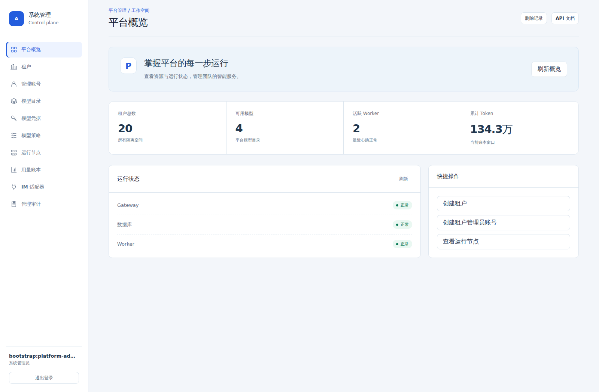
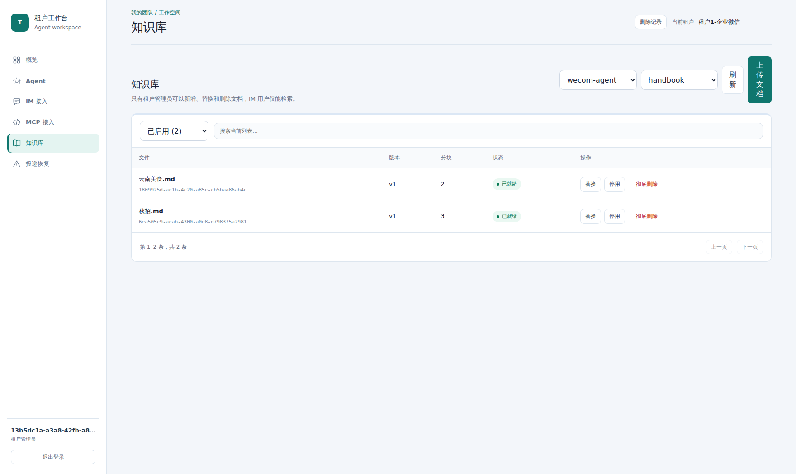
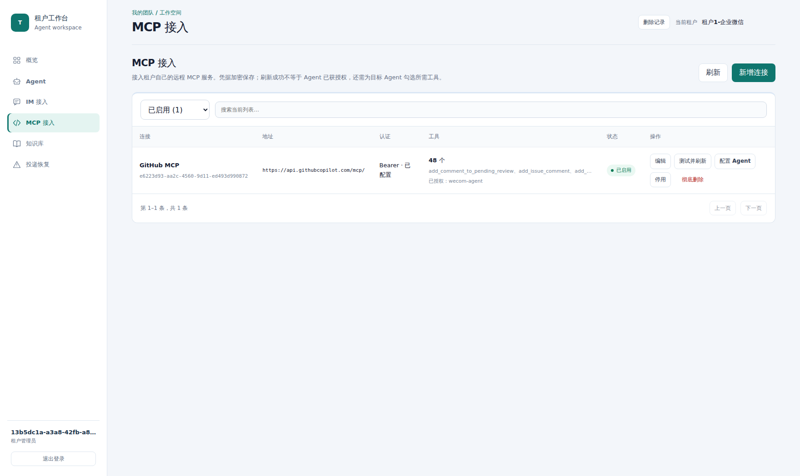
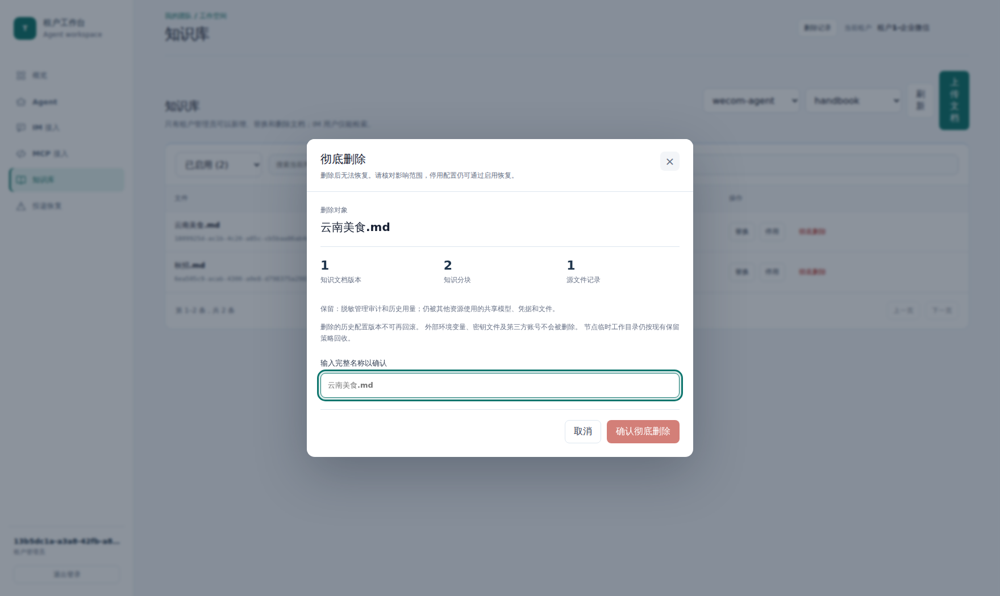

# 截图索引

更新日期：2026-10-13，代码基线 `89d213d`。本轮替换 5 张旧图，新增 8 张，保留无法重新取得的 5 张历史截图。

管理页面使用 Playwright 从已启动的 `http://127.0.0.1:8000` 实际截取，使用现有企业微信租户的数据。没有修改页面上的统计数字、工具列表或业务状态。截图所用的临时管理凭据已撤销，未改动机器人 ID、Secret 或现有账号密码。

## 本轮替换

| 图片 | 来源与范围 |
| --- | --- |
| [默认自动化测试](01-automated-tests.png) | 本轮运行 `tests/`：475 通过、2 跳过。由实际 pytest 日志及 JUnit 结果排版后截图，不含新的覆盖率数据 |
| [健康接口](03-service-health.png) | 实际请求 `/health` 和 `/ready` 后展示返回值；采样时均为 HTTP 200，数据库可查询、活跃 Worker 为 2 |
| [知识库列表](06-rag-add-confirm.png) | 当前文档、版本、分块及停用／彻底删除入口；文件名沿用旧图，不表示本轮重新上传了文档 |
| [替换知识文档](07-rag-update-confirm.png) | 打开替换窗口并选择 `设计思路.md`，未点击“上传并写入”，现有知识内容没有被替换 |
| [GitHub MCP 接入](08-mcp-agent-grant.png) | 当前目录显示 48 个工具，已授权 Agent 为 wecom-agent；本轮没有重新刷新远端目录或执行工具 |

测试和健康图是实际结果的报告截图，其余为网页原始截图。健康检查和配置可见不等于完成了模型、RAG 检索或 IM 收发验收。

## 本轮新增

| 图片 | 展示内容 |
| --- | --- |
| [系统管理员登录](11-platform-login.png) | `/admin` 登录入口，凭据输入框为空 |
| [租户管理员登录](12-tenant-login.png) | `/tenant` 登录入口，凭据输入框为空 |
| [平台概览](13-platform-overview.png) | 截图时的租户、模型、Worker 与账本窗口统计 |
| [租户列表](14-platform-tenants.png) | 默认启用筛选、编辑、停用与彻底删除入口 |
| [运行节点](15-runtime-workers.png) | Worker Pool 期望与实际节点数，以及各角色的心跳 |
| [租户概览](16-tenant-overview.png) | 现有企业微信租户的 Agent、IM 接入、知识文档与异常投递数量 |
| [文档删除预览](17-document-deletion-preview.png) | 真实影响数量及名称确认框；只打开预览，没有提交删除 |
| [MCP 工具授权](18-mcp-tool-permissions.png) | Agent 编辑窗口中的授权勾选与写操作确认标识；没有保存修改 |

## 保留的历史截图

| 图片 | 本轮保留原因 |
| --- | --- |
| [Docker Desktop Kubernetes](02-kubernetes-components.png) | 无法直接截取 Windows 上的 Docker Desktop 窗口，本轮也未重新部署 Kubernetes |
| [飞书对话](04-feishu-chat.png) | 无法直接访问已登录的飞书客户端 |
| [企业微信图片对话](05-wecom-chat.png) | 无法直接访问已登录的企业微信客户端 |
| [GitHub MCP 历史对话](09-github-test.png) | 原图来自 IM 客户端，展示机器人对能力的介绍；不能单独作为工具执行成功的证据 |
| [飞书知识库历史回答](10-governance-approval.png) | 保留原图及文件名；画面是知识库问答，不是后台审批页面，也不能单独证明跨租户隔离 |

这些原图没有改动。历史测试的条件和结论见 [测试结果](../测试结果.md)，不能用旧客户端画面证明本轮已经重测。

## 页面预览

平台概览：

租户知识库：

GitHub MCP 接入：

文档删除预览：

## 本地记录

截图脚本、原始测试日志、JUnit XML、健康接口返回值和替换前备份保存在 `dev/screenshots/`，均被 Git 忽略。图片与本页说明保存在 `docs/images/`，克隆仓库即可阅读。

本轮没有调用真实 LLM，没有向外部 IM 发送消息，没有提交知识替换、Agent 修改、资源删除或扩缩容操作。除了读取审计，认证过程只新增并撤销了一条临时管理凭据；撤销记录作为审计保留。
