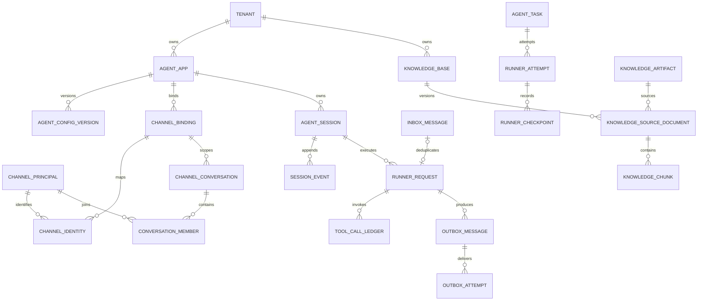
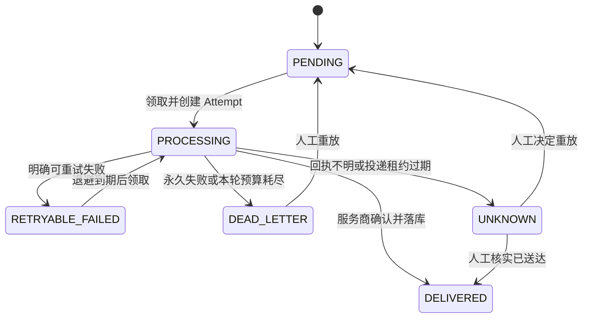

# 存储表结构

基线：2026-09-29，Alembic Head 为 `20260924_0028`。以下说明运行时使用的数据和约束；完整字段以 ORM 和迁移为准，不把规划中的表混入现有结构。

## 存储分工

PostgreSQL 保存配置和业务事实，pgvector 在当前 PostgreSQL 后端中保存知识向量。Redis 只缓存近期 Session，SeaweedFS 通过 S3 接口保存文件正文。模型调用、远端 MCP、对象写入和 SQL 不属于同一事务。

## 核心关系

图中展示业务关联，具体组合外键和可空列以 ORM 为准。



## 配置与管理

| 表 | 保存内容与约束 |
| --- | --- |
| `tenant` | 租户名称、状态、隔离模式和审计策略 |
| `agent_app` | 租户 Agent、模型引用、能力配置及稳定/灰度版本指针 |
| `agent_config_version` | 以租户、Agent、版本为键的配置快照，已发布快照不原地修改 |
| `model_catalog_entry` | 模型目录与供应商信息 |
| `model_provider_credential` | 平台供应商凭据引用，不保存 API Key 明文 |
| `model_profile` | 分配给租户的模型参数、配额、超时和单价 |
| `management_principal`、`management_role_assignment` | 管理身份与角色，唯一租户管理员约束 |
| `management_password_credential`、`management_credential`、`management_web_session` | 密码摘要、Token 摘要和浏览器会话 |
| `tenant_secret` | 租户加密凭据，渠道与 MCP 使用不同作用域引用 |
| `channel_adapter_type` | 已部署 Adapter 的能力与配置 Schema |
| `mcp_connection` | 租户连接、认证引用、工具目录、刷新时间和状态 |
| `worker_pool_control` | 全局 Worker Pool 的期望节点数、generation 和修改者 |
| `runtime_node` | 角色、并发度、心跳和运行状态，不代替期望状态表 |

当前没有独立 `storage_profile` 表。后端名称与连接由平台 Settings 配置，Agent 版本可保存后端路由选择。表中出现 `schema/database` 等隔离模式字段，不代表每个租户已实际部署独立数据库；当前测试使用共享后端和租户范围约束。

## 身份与会话

| 表 | 关键范围 |
| --- | --- |
| `channel_binding` | 归属 Tenant 和 Agent，活动外部账号以渠道类型及账号哈希唯一 |
| `channel_principal` | 租户内的 IM 对话者身份 |
| `channel_identity` | `(tenant_id, binding_id, provider_principal_id)` 唯一 |
| `channel_conversation` | `(tenant_id, binding_id, provider_conversation_id)` 唯一，区分私聊、群聊和线程 |
| `conversation_member` | 会话成员关系，不放在自由 JSON 中代替关系约束 |
| `agent_session` | `(tenant_id, agent_app_id, session_id)` 主键，保存 State、version、last_event_seq 与最近提交 fence |
| `session_event` | Session 内追加事件，序号和提交版本分开保存 |
| `session_summary` | 每个 Session 的最新摘要及来源事件高水位 |
| `memory_record` | Tenant、Agent 及可选 Principal 范围内的记忆记录 |

Session `version` 是提交版本，`last_event_seq` 是事件位置，不能混用。最终提交同时检查预期版本和执行 fence。Redis 条目带同样的租户、Agent 和 Session 范围，只有版本一致才可作为近期快照使用。

当前 Runner 读取 Memory/Summary，但没有每轮自动抽取长期记忆的运行流程。

## 队列、执行和幂等

| 表 | 关键字段或唯一约束 | 作用 |
| --- | --- | --- |
| `agent_task` | `(tenant_id, binding_id, external_message_id)` 唯一；保存规范化请求、routing_key、attempt_count、lease_owner、lease_token、lease_until | 入站持久队列及任务执行权 |
| `inbox_message` | 同样以租户、Binding、外部消息 ID 去重；另有 `(tenant_id, request_id)` 唯一 | Pipeline 执行事实、正文哈希和已提交结果关联 |
| `runner_request` | `(tenant_id, request_id)` 主键，一个 Inbox 最多对应一个 Runner Request | 保存执行状态、配置版本与恢复结果 |
| `session_execution_fence` | `(tenant_id, agent_app_id, session_id)` 主键；issued_token、lease_owner、lease_until | 同 Session 的执行权和提交校验 |
| `runner_attempt` | task、request、node、attempt_no、fencing_token、status | 每次 Worker 尝试的诊断记录 |
| `runner_checkpoint` | Attempt 内有序阶段与 state_ref | 记录已到达的运行阶段，不保存整个 SDK 内存快照 |
| `tool_call_ledger` | `(tenant_id, agent_app_id, request_id, logical_call_index)` 唯一 | 记录参数意图、外部调用状态和可重放结果 |

实际 IM 入口先幂等写 `agent_task`，Pipeline 随后建立 Inbox/Runner 执行状态；不要把二者描述为同一张表。相同外部消息 ID、不同正文会被冲突校验拒绝。相同文字但新的外部消息 ID 是新请求。

`agent_task` 状态为 `queued/running/succeeded/retryable_failed/permanent_failed`。领取任务时增加 `attempt_count` 和 `lease_token`。SQL 筛选同 Session 最早未完成任务，再用 `FOR UPDATE SKIP LOCKED` 竞争，续租、完成和失败均需当前 token。

Tool Ledger 状态为 `PREPARED/SUCCEEDED/FAILED/UNKNOWN`。已成功结果可以重放；结果未知时不能直接重复外部调用。任务 token 与 Session fence 是不同层的令牌，不能因为数值相同就互相代用。

## 回复 Outbox

`outbox_message` 保存回复正文或引用、目标 Binding、Session、序号、幂等键、状态、重试时间、租约和外部回执。唯一约束包括 `(tenant_id, agent_app_id, category, idempotency_key)` 和 `(tenant_id, agent_app_id, request_id, sequence_no)`。

`outbox_attempt` 以 `(tenant_id, agent_app_id, outbox_id, attempt_no)` 保证一次尝试只有一条记录，保存执行者、开始/结束时间、结果及安全错误摘要。



图省略清理用途的 CANCELLED。当前消费者仅处理 `IM_REPLY`，没有运行 Memory、Audit、Knowledge 的通用投影消费者。

投递租约过期不重新发送：原 Outbox 和 Attempt 转 UNKNOWN，清除租约，不增加尝试编号。同回复流前序 UNKNOWN 阻挡后续发送。确认已送达只改变业务状态并记录审计，原 Attempt 不被改写为服务商成功。

`attempt_count` 累计递增，`retry_count` 统计当前投递周期，人工重放只重置后者。`20260924_0028` 增加回复流前序查询索引，字段包括租户、Agent、Binding、Session、状态、创建时间和序号。

## 知识与文件

| 表 | 用途 |
| --- | --- |
| `knowledge_base` | 租户知识库名称、状态、Embedding 模型与维度 |
| `knowledge_artifact` | 文件名、类型、哈希、大小、对象 URI；正文在 S3 |
| `knowledge_source_document` | 文档版本、校验和、状态、错误摘要和 Chunk 数 |
| `knowledge_chunk` | 原文切片、字符范围、内容哈希与来源 document_id |
| `knowledge_chunk_vector` | Chunk 的向量投影、租户与知识库范围，当前 1024 维 |

文档状态为 `INGESTING/READY/FAILED/SUPERSEDED/DELETED`。相同租户知识库中的文件 checksum 用于摄取幂等，同文件名与版本也有唯一约束。

检索先得到向量候选，再按 SQL 中当前租户、授权知识库、READY 来源过滤。删除和替换后，残留向量不会绕过文档状态重新进入结果。删除不等于清空原始对象；对象引用回收和通用 Legal Hold 尚未实现。

更换 Embedding 模型会改变向量空间，模型名不一致时禁止直接混用。当前没有正式交付的批量重建索引命令。

## 预算、审批与审计

| 表 | 说明 |
| --- | --- |
| `usage_ledger` | `(tenant_id, request_id)` 唯一；保存 reserved_tokens、输入/输出/总 Token、估算成本，状态为 reserved/completed/cancelled |
| `approval_request` | 绑定租户、Agent、Binding、Principal、Session、配置版本和调用意图的持久确认 |
| `audit_log` | 运行审计，带请求、Trace、会话、决策、工具、耗时和安全摘要 |
| `management_audit_log` | 配置变更、支持访问、投递核对与重放的操作者审计 |

审批短码不是通用授权凭据，只能由符合原请求范围的身份消费。当前 RAG 写操作走管理 API，不通过 IM 模型审批获得上传或删除能力。

## 事务与恢复边界

一次成功执行的 Session 事务包括：

1. 校验 Inbox/Runner 状态、Session 版本和 fence。
2. 追加 Event，更新 State、version 和 last_event_seq。
3. 更新 Inbox 与 Runner 的成功结果。
4. 插入 Reply Outbox。

事务之外还有任务完成标记、Usage Ledger、Tool Ledger、Attempt/Checkpoint 和审计。因此存在“结果已提交、任务仍运行”的窗口；接管者必须先检查已有结果，而不能无条件再次运行模型。

SQL 提交与 IM 接收之间没有分布式事务。UNKNOWN 与人工核对保留这个事实，不把外部结果伪装成本地已知。

## 迁移与代码依据

迁移应在应用启动前执行，再运行存储准备：

```bash
uv run alembic -c trpc_service/storage/alembic.ini upgrade head
uv run python -m trpc_service.storage.provision
```

当前没有独立 `projection_checkpoint` 或通用外部向量库同步消费者。启用新后端需要单独实现回填、版本核对、失败恢复和回滚，不能仅修改文档中的路由名称。

- [运行事实 ORM](../trpc_service/storage/runtime_orm.py)
- [知识 ORM](../trpc_service/storage/knowledge_orm.py)
- [渠道与身份 ORM](../trpc_service/channels/models.py)
- [管理 ORM](../trpc_service/admin/models.py)
- [迁移目录](../trpc_service/storage/migrations/versions)
