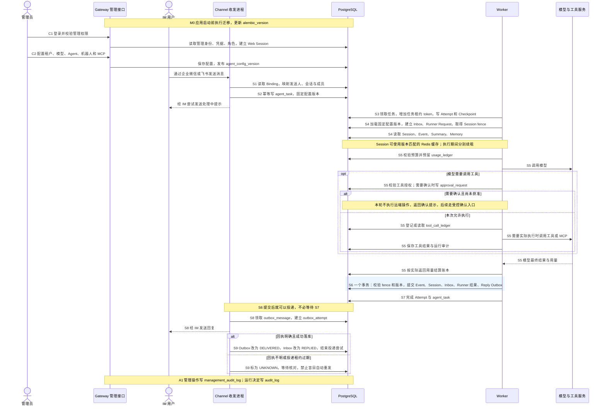
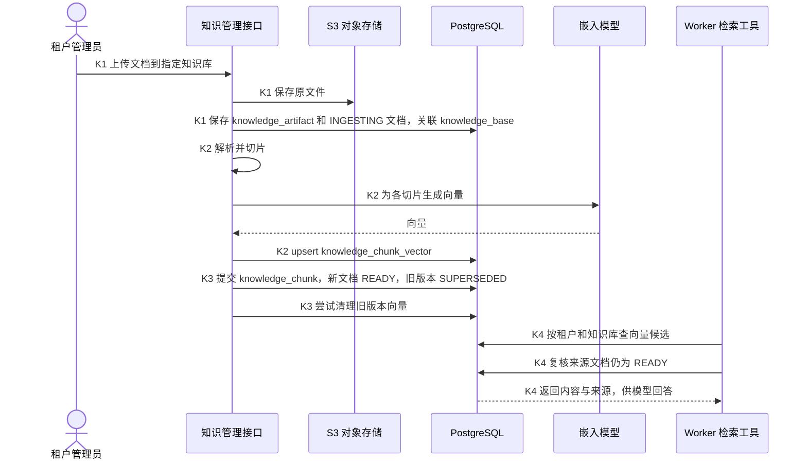
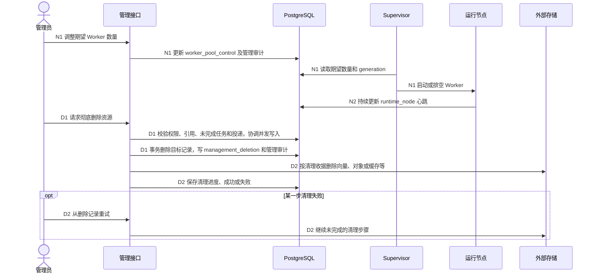
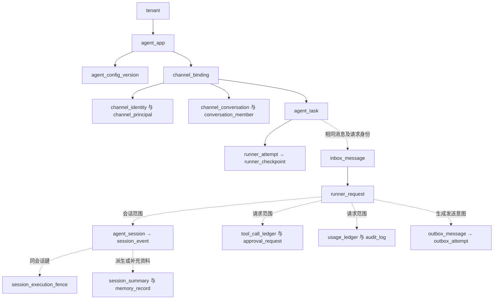

# 从一条消息看懂数据表

核对日期：2026-10-06。代码基线 `89d213d`，迁移最新版本 `20260930_0029`，共 29 个迁移文件。当前 ORM 定义 **44 张应用表**，另有 Alembic 使用的 `alembic_version`。下面讲的是代码规定的结构，没有连接本地数据库核查它是否已经升级到此版本。

先看时序，再按表阅读。每张表都标出对应步骤、主键、业务唯一规则和拆表原因。完整字段、类型、可空性、外键和索引见配套的 [数据库字段字典](数据库字段字典.md)。

## 1. 先看时序图

### 1.1 配置完成后，一条普通消息怎样经过数据库

步骤编号是本篇的定位标记，不表示每个箭头只有一条 SQL。数据库操作分成多个短事务，调用模型和 IM 时不会一直占着同一笔事务。

Gateway 管配置，Channel 直接接 IM 长连接，Worker 执行任务。不要把它理解成每条消息必须先经过 Gateway HTTP。S5 的预算、工具账本、审计各有自己的事务，也不是全部包在 S6 中。图中省略了明确可重试失败与永久失败分支，具体状态转换见第 33 表及运行时序文档。

### 1.2 知识文件为什么需要五张表

向量表可能使用独立配置的 PostgreSQL 连接，向量写入、文档发布与对象存储不是一笔跨系统事务。文件可能存成功而解析失败，所以必须有单独的文档状态。K4 是主图 S5 中检索工具调用的一种。

### 1.3 扩缩容与删除是另外两条流程

数据库里资源记录删掉后，清理收据仍要存在。否则 S3 删除失败时，系统连“还有哪个文件要删”都记不住。

## 2. 看表之前，分清五件事

| 概念 | 作用 | 本项目例子 |
| --- | --- | --- |
| 主键 PK | 唯一定位一条记录，不能为 NULL | `agent_task.task_id` |
| 业务唯一约束 UQ | 同一件业务不能因不同随机主键而插入两遍 | 租户、机器人绑定、外部消息 ID 的组合唯一 |
| 外键 FK | 被引用记录必须存在；组合外键还校验归属 | Binding 的租户和 Agent 必须一起对应某个 Agent |
| 普通索引 | 加快筛选、排序与关联，不自动去重 | 队列按状态、下次重试时间查任务 |
| 应用校验和状态转换 | 判断重复内容是否一致、旧执行者能否提交、是否可以重试 | `payload_hash`、fence、版本和 UNKNOWN 检查 |

**UUID 主键防止的是“记录 ID 重复”，业务唯一键防止的是“同一件事被建成两条记录”。** 两个 Worker 可以各生成不同 UUID，但如果外部消息 ID 相同，数据库仍必须只接受一项业务。

下文写 `PK(a, b)` 就是 a、b 两列共同组成主键；写 `UQ(a, b)` 就是两列合起来不能重复。单列不一定各自唯一。外键只保证关系存在，不替代请求权限检查。

带 `tenant_id` 的组合键，既给数据标明归属，也允许不同租户安全使用相同的局部 ID。某些表已有全局 UUID 主键，仍额外设置 `UQ(tenant_id, id)`，是为了让别的表能建立带租户的组合外键。

PostgreSQL 的普通唯一约束允许多行 NULL。项目用部分唯一索引补上“平台角色 tenant_id 为 NULL 时仍不能重复”的规则。哈希字段也不天然唯一：只有主键、唯一约束或唯一索引明确约束的列才在数据库层去重。

## 3. 管理身份、配置与密钥：14 张

### 01. `tenant`：租户根记录

**对应 C2、S1、D1。** 保存租户名称、启停状态、`isolation_mode` 和审计策略。`PK(tenant_id)`；`UQ(name)` 防止平台内租户重名。UUID 作为稳定身份，改名称不需要改所有引用。

它与 `agent_app`、`model_profile`、`channel_binding`、`knowledge_base` 联合看。一个租户可以有多种资源，若把这些塞进租户一行 JSON，就难以单独授权、约束引用和管理生命周期。隔离模式字段存在，不等于已为每个租户实际创建独立数据库。

### 02. `management_principal`：谁在管理平台

**对应 C1、A1。** 保存人或服务身份、显示名、外部主体标识和状态。`PK(management_principal_id)`；`UQ(external_subject)` 防止同一管理主体重复开户，显示名不要求唯一。

它回答“你是谁”，不保存“你用什么密码登录”和“你能管哪个租户”。后两者分别在凭据与角色表里，方便一个身份使用不同登录方式，并分别撤销权限或凭据。

### 03. `management_role_assignment`：管理身份的权限范围

**对应 C1、C2、D1。** `PK(role_assignment_id)`；`UQ(management_principal_id, tenant_id, role)` 防止重复授予同一租户角色。

还有三项部分唯一索引：tenant_id 为 NULL 时，`(management_principal_id, role)` 唯一，避免重复平台管理员角色；tenant_id 非空时，`tenant_id` 唯一且 `management_principal_id` 唯一，落实“一个租户一个管理员、一个租户管理员身份对应一个租户”。检查约束要求平台管理员不带租户，租户管理员必须带租户。

联合 `management_principal` 与 `tenant` 判断权限。它不是 IM 群成员表；机器人对话者不会因为发过消息就获得管理权限。

### 04. `management_password_credential`：密码登录资料

**对应 C1。** `PK(password_credential_id)`；`UQ(username)` 防止用户名重名；`UQ(management_principal_id)` 保证一个管理主体最多一套密码凭据。保存密码哈希、失败次数、锁定截止时间和改密时间。

密码只需验证，不需要还原，因此保存哈希。它与身份分开，让改密、锁定登录不会改变资源归属。哈希本身不设唯一，因为两个用户可以使用相同密码，密码也不能作为用户身份。

### 05. `management_credential`：管理 API Token

**对应 C1。** `PK(credential_id)`；`UQ(token_hash)` 保证同一个 Token 摘要只对应一份凭据。保存名称、Token 前缀、状态、有效期和最近使用时间，关联管理主体。

一位管理员可以有多个可独立吊销的 API Token，因此不能只在身份表里放一个 token 字段。数据库保存摘要用于验证，不保存完整明文 Token。

### 06. `management_web_session`：浏览器登录会话

**对应 C1。** `PK(web_session_id)`；`UQ(token_hash)` 唯一识别浏览器持有的登录令牌。保存管理主体、CSRF 摘要、有效期、撤销时间、最近活动时间。

一个人可以同时在多个浏览器登录，所以它与身份是一对多。退出某次登录只需撤销对应会话，不必改密码或删除身份。这里的 Session 是控制台登录会话，和机器人聊天的 `agent_session` 不同。

### 07. `tenant_secret`：租户的加密密钥材料

**对应 C2、S1、S5。** `PK(tenant_secret_id)`；`UQ(tenant_id, name)` 防止同租户内密钥名歧义。保存密文 `ciphertext`、加密随机量 `nonce`、密钥版本和状态。

渠道、模型或 MCP 使用时需要取回原始密钥，所以这里采用可解密加密，而非密码式单向哈希。配置表只保存引用，避免每份配置快照都复制密钥。与 `channel_binding.secret_ref_map`、`mcp_connection.secret_ref`、租户自管的 `model_profile.secret_ref` 联合看；这些引用主要由服务解析，不是全部由数据库外键约束。

### 08. `model_catalog_entry`：平台允许提供哪些模型

**对应 C2、S4。** `PK(model_catalog_id)`；`UQ(provider, model_name)` 防止同一供应商同一模型重复登记。保存能力、默认限制、可选平台密钥引用和状态。

这是模型公共信息。一种模型可以分配给很多租户，但租户额度和参数不同，因此公共目录与租户的 `model_profile` 分开。

### 09. `model_provider_credential`：平台供应商凭据引用

**对应 C2、S4–S5。** `PK(model_credential_id)`；`UQ(provider, name)` 保证同供应商内凭据名称唯一。保存 `secret_ref` 和状态，不保存 API Key 明文。

同一模型可以选择不同供应商账号，一份平台凭据也可被多个租户模型配置引用。拆出来便于轮换、停用和检查删除依赖；凭据名不是模型名。

### 10. `model_profile`：给某个租户使用的模型配置

**对应 C2、S4–S5。** `PK(model_profile_id)`；`UQ(tenant_id, name)` 防重名；`UQ(tenant_id, model_profile_id)` 供带租户的外键引用。保存模型目录 ID、凭据模式、平台凭据 ID 或租户密钥引用、参数和限制。

联合 `tenant → model_profile → model_catalog_entry` 看“谁使用哪种模型”；再看凭据表确认“使用谁的账号”。凭据模式约束区分租户自管和平台托管，不能把两个来源随意混用。Agent 引用它，而不是重复存一套供应商公共资料。

### 11. `agent_app`：Agent 身份和当前发布指针

**对应 C2、S1、S4。** `PK(agent_app_id)`；`UQ(tenant_id, name)` 防同租户重名；`UQ(tenant_id, agent_app_id)` 供组合外键引用。关键字段包括模型引用、工具权限、知识配置、后端配置，以及稳定版本和灰度版本指针。

Agent 可长期存在而不断发布新配置，所以与 `agent_config_version` 分开。`(tenant_id, model_profile_id)` 的组合外键防止误用其他租户的模型配置。代码属性 `model_settings` 对应的实际数据库列名是 `model_config`。

### 12. `agent_config_version`：一次请求选中的配置快照

**对应 C2 发布，S2 固定版本，S4 加载。** `PK(tenant_id, agent_app_id, version)`，同一 Agent 的版本号不能重复。保存完整 `snapshot`、状态、创建者和原因；状态为 draft、released、retired。

例子：请求排队时使用 v3，管理员随后发布 v4，旧请求仍能按 v3 执行，排障时也知道当时用了什么。发布后不原地修改是应用层约定，不能仅凭“快照”这个名字就当成数据库禁止 UPDATE。工具权限、Skill/MCP 授权等存于配置 JSON，没有逐项拆成授权关系表；代价是部分引用检查需要服务代码完成。

### 13. `channel_adapter_type`：平台支持哪些渠道类型

**对应 C2、S1。** `PK(channel_type)`，如企业微信、飞书的渠道类型键，自身就能去重。保存 Adapter 版本、配置格式、密钥格式和能力说明。

这是“平台支持什么类型”，`channel_binding` 才是“某租户实际配置了哪个机器人”。前者通常一类一条，后者一类可有多条，合并会反复复制同一份渠道格式说明。

### 14. `channel_binding`：具体机器人绑定到哪个租户和 Agent

**对应 C2、S1、S8。** `PK(binding_id)`；`UQ(binding_public_id)` 给外部入口稳定的公开标识；`UQ(tenant_id, binding_id)` 供组合外键引用。

最关键的是部分唯一索引：**仅 active 行的 `(channel_type, external_account_hash)` 全局唯一**。同一机器人账号不能被两个活跃绑定同时占用，旧绑定停用后才允许转移。账号哈希帮助稳定识别机器人，不是正文去重哈希。

与 Agent 的 `(tenant_id, agent_app_id)` 组合外键保证归属；保存账号配置、密钥引用、能力及状态。`channel_type` 与 Adapter 目录是业务关联，目前没有该列到目录表的数据库外键。

## 4. IM 身份与群聊：4 张

### 15. `channel_principal`：租户内的对话主体

**对应 S1、S4。** `PK(tenant_id, principal_id)`，没有按显示名去重。保存主体类型、名称、状态和属性。

它表示“是谁”，`channel_identity` 表示“通过哪个渠道账号识别这个人”。当前身份服务用租户、Binding 和外部用户 ID 生成确定性 UUID；同一输入得到同一身份。虽然结构允许身份映射，当前流程不会自动把飞书和企业微信用户合并成同一个人。

### 16. `channel_identity`：外部用户 ID 到内部主体的映射

**对应 S1。** `PK(tenant_id, identity_id)`；`UQ(tenant_id, binding_id, provider_principal_id)` 防止同一机器人下的外部用户被映射两次。组合外键分别指向 Binding 和 Principal。

外部用户 ID 只在特定渠道/机器人范围内有意义，不能直接当全平台用户主键。它还记录最近出现时间，渠道映射变化不必重建主体资料。当前使用确定性 ID 与冲突后重读，处理首次消息并发插入。

### 17. `channel_conversation`：外部私聊、群聊或线程

**对应 S1。** `PK(tenant_id, conversation_id)`；`UQ(tenant_id, binding_id, provider_conversation_id)` 防止同一绑定下重复建会话。保存会话类型、标题、状态、最近消息时间。

它描述 IM 侧的聊天空间，不保存模型运行历史。`agent_session` 描述 Agent 的上下文，两者生命周期不同；当前代码通过 Binding 和内部 Conversation ID 派生 session_id，这不是两表之间的实体外键。

### 18. `conversation_member`：谁属于哪个聊天空间

**对应 S1。** `PK(tenant_id, conversation_id, principal_id)` 直接防止同一个人重复加入同一个会话记录。两组组合外键指向 Conversation 和 Principal；保存成员角色及状态。

一个群有多人，一个人也可在多个群，这是多对多关系，所以单独一张关联表。把群成员存为数组会更难独立更新和约束重复。当前入口记录观察到的发言者，不意味着已经同步 IM 平台的完整群成员名单。

## 5. 任务、会话与执行恢复：10 张

### 19. `agent_task`：等着 Worker 处理的任务

**对应 S2、S3、S7。** `PK(task_id)`；`UQ(tenant_id, binding_id, external_message_id)` 是入站业务去重键。关键字段包括请求快照、配置版本、`routing_key`、状态、尝试次数和任务租约。

重复回调可能带来新的 request_id/trace_id，所以不能拿本次 HTTP 或入口生成的请求 ID 识别渠道重放。先按稳定的外部消息身份定位，再比较 `payload_hash`；同 ID 不同内容拒绝。同样文字但不同外部消息 ID，则是新任务。

并发首次插入时，应用先查、再在保存点中插入，唯一约束裁决竞争，失败者重新读取已有行。领取时用行锁、`SKIP LOCKED` 和同会话队首检查；`lease_token` 递增，旧领取者不能续租或完成。`routing_key` 不唯一，因为同会话当然可以排多个任务。

它是调度待办，与 `inbox_message`、`runner_request` 的业务处理记录分开。任务已被接收但尚未执行时，可以只有队列记录；结果已提交但任务完成标记还没写时，三者也可能处于不同阶段。

### 20. `inbox_message`：这条入站消息处理到哪了

**对应 S4、S6、S9。** `PK(inbox_id)`；三项唯一约束分别为 `UQ(tenant_id, binding_id, external_message_id)`、`UQ(tenant_id, request_id)`、`UQ(tenant_id, inbox_id)`。最后一项供 Runner 的组合外键使用。

它保存正文哈希、执行状态、尝试与租约信息、已提交会话版本、结果状态和 `reply_outbox_id`。队列里的 succeeded 表示调度任务完成；Inbox 可以进一步从 SUCCEEDED 走到 REPLIED，表示关联回复已经送达。

与 Task 看同一入站身份，与 Runner 看逻辑执行，与 Outbox 看回复关联。`reply_outbox_id` 是应用维护的关联字段，不是已经声明的 Outbox 外键。单独保留这张表，使接管者能判断“已经处理过，直接复用结果”，不必重新调用模型。

### 21. `runner_request`：一次逻辑 Agent 请求

**对应 S4–S6。** `PK(tenant_id, request_id)`；`UQ(tenant_id, inbox_id)` 保证一个非空 Inbox 最多映射一个 Runner Request。`inbox_id` 可空，因此不是所有 Runner 行都强制有 Inbox。

关键字段包括 Agent、Session、配置版本、执行状态、步骤和工具调用位置、状态引用、Session fence 和尝试次数。它描述“这个请求要完成什么、进行到哪里”，不是某个 Worker 进程的一次尝试。

同一逻辑请求可能由先后两个 Worker 执行，两次尝试都应指向同一个请求。当前检查点和状态字段不等于任意 SDK 内存都能断点恢复；已有持久结果重放与未提交部分重新执行需要区分。

### 22. `agent_session`：当前聊天状态

**对应 S4 读取、S6 更新。** `PK(tenant_id, agent_app_id, session_id)`，每个租户 Agent 会话只有一份当前状态。保存 `state`、`version`、`last_event_seq`、最近提交的 fence、状态和活动时间。

State 是便于继续对话的当前状态，Event 是形成状态的事件历史，所以拆成两张表。`version` 表示成功提交了多少个状态版本，`last_event_seq` 表示事件排到哪里，一次提交可包含多条事件，不能混用。

最终提交检查预期版本和 Session fence。主键只防重复建 Session，不会单独阻止两个进程同时覆盖状态。Redis 是这一事实的可丢弃缓存，不能代替数据库提交检查。

### 23. `session_execution_fence`：谁有资格提交这个会话

**对应 S4 领取与续租、S6 校验。** `PK(tenant_id, agent_app_id, session_id)`，同一会话只有一个当前执行资格记录。保存递增 `issued_token`、拥有者和到期时间。

它与 Session 状态分开，允许先取得执行资格，再准备或提交会话状态。当前只有到 Agent 的组合外键，没有到 `agent_session` 的外键，不能认为它必须晚于 Session 行创建。

Task 租约约束“谁拥有这项队列任务”，Session fence 约束“谁有资格改变会话”。A 暂停、B 接管后，A 即使恢复也不能凭旧代数提交。租约和主键不会自动停止 A 的计算，必须在写入边界检查 token。

### 24. `session_event`：聊天中的有序事件历史

**对应 S4 读取、S6 追加。** `PK(tenant_id, agent_app_id, session_id, seq_no)` 防同一会话位置重复；另有 `UQ(tenant_id, agent_app_id, event_id)` 防同一事件 ID 在该 Agent 范围重复写入。

保存事件类型、发生者、请求、Trace、载荷和 `committed_version`。组合外键指向 Session。需要恢复历史、追踪某次请求产生什么时看 Event；只看当前状态时用 Session，避免每次都扫描全历史。

seq_no 是顺序位置，event_id 是事件身份，两种约束解决不同问题。追加式使用是代码约定，不等于数据库表本身禁止管理员执行 UPDATE。

### 25. `session_summary`：当前会话摘要

**对应 S4 读取；摘要存储接口按需更新。** `PK(tenant_id, agent_app_id, session_id)`，一份会话只保存最新摘要。`source_event_seq` 表示摘要已经覆盖到第几条事件，而不是摘要版本号随便加一。

与 Session/Event 联合看才能判断有没有漏掉摘要之后的消息。应用拒绝较旧或相同来源位置覆盖较新摘要，不能只靠主键保证新旧顺序。它是可重建的压缩内容，所以没有与全部历史合并，也没有声明到 Session 的外键。

### 26. `memory_record`：可跨轮次使用的记忆

**对应 S4 读取；Memory 存储接口按需写入。** `PK(tenant_id, agent_app_id, memory_id)`，没有内容哈希唯一约束。`principal_id` 在 SQL 中非空，标明所属主体；保存内容和属性，按主体范围建立查询索引。

同一记忆 ID 可更新内容，重复文字但新 ID 不会被数据库自动合并。它描述长期保留的信息，Summary 描述某段会话历史的压缩，所以二者不能等同。当前 Runner 会读取它们，但没有每轮自动抽取全部长期记忆的后台流程；该表没有到渠道 Principal 的数据库外键。

### 27. `runner_attempt`：某个 Worker 的一次执行尝试

**对应 S3 创建、S7 结束。** `PK(tenant_id, attempt_id)`；`UQ(tenant_id, task_id, attempt_no)` 保证同一任务的第 N 次尝试只有一条记录。保存节点、请求、尝试号、状态、时间和错误摘要，外键关联 Task。

一个 Task 因故障可能经历多次 Attempt，因此不能用一行反复覆盖来替代尝试历史。这里的 `fencing_token` 来自 **AgentTaskClaim 的任务 lease_token**，不要误以为所有名为 fencing_token 的字段都保存 Session fence。

### 28. `runner_checkpoint`：一次尝试中经过哪些阶段

**对应 S3、S4–S7 的阶段记录。** `PK(tenant_id, attempt_id, sequence_no)`；组合外键指向 Attempt。保存阶段名、状态引用和时间，尝试内部按序追加。

Attempt 说明“哪一次运行”，Checkpoint 说明“这一次走到了哪一步”。一对多拆表方便看失败位置，不把阶段列表反复覆盖为一大段 JSON。它不是进程内存快照，也不是把每个 token 都持久化。

## 6. 工具、审批与用量：4 张

### 29. `tool_call_ledger`：工具调用意图与结果

**对应 S5。** `PK(tenant_id, agent_app_id, call_id)`；`UQ(tenant_id, agent_app_id, request_id, logical_call_index)` 防同一请求的同一逻辑调用位置出现两份记录。保存工具名、动作、资源、`intent_hash`、结果和状态。

主键识别调用，逻辑位置键限制重试映射，意图哈希判断“这次重放真的是原来的操作吗”。相同调用身份换了参数会被拒绝；单独按工具名或参数去重反而会吞掉用户合法的再次调用。

PREPARED 表示已登记、外部结果尚未确认；SUCCEEDED 可重放保存结果；UNKNOWN 不允许盲目重做。远端工具副作用不能跟 SQL 一起回滚，所以这张表要独立记录，不能只写在最终聊天回答里。

### 30. `approval_request`：对某个确切操作的人工确认

**对应 S5 的待确认分支。** `PK(approval_id)`；`UQ(tenant_id, agent_app_id, tool_call_id)` 防同一逻辑操作反复创建审批；`UQ(short_code)` 保证确认短码全局唯一。

保存租户、Agent、Binding、用户、Session、配置版本、工具、资源、参数哈希、原附件范围、风险等级和执行状态。短码负责找到审批，身份和参数范围检查负责确认“这位用户同意的是这件事”。知道短码不代表拿到通用写权限。

它记录许可，Tool Ledger 记录执行结果，用户已批准不等于远端已成功。两张表一起看。历史 `operation_arguments` 列仍在，当前新流程刻意留空，不能推断已有通用 RAG 操作自动恢复能力。

### 31. `usage_ledger`：请求的预算预留和用量结算

**对应 S5；失败/取消路径也可能更新。** `PK(usage_id)`；`UQ(tenant_id, request_id)` 防同请求重复建立账本。保存 Agent、模型、输入/输出/总 tokens、预留量、估算成本和发生时间。

状态从 reserved 到 completed，或释放为 cancelled；同一行会发生状态更新，不能把它描述成每次变化都追加新行的纯流水。并发预算还靠租户范围的数据库协调和原子检查，唯一键本身不能保证所有不同请求加起来不超额。

这张表是请求级汇总，不是每一个底层模型 HTTP 调用一条账。与 Task 按租户和请求关联，而非假设存在到 Runner 的外键。最新迁移移除了到 Agent 的外键，资源删除后用量仍可保留；Prometheus 统计不能替代它。

### 32. `mcp_connection`：一个租户的远程 MCP 接入

**对应 C2、S4、S5。** `PK(connection_id)`；`UQ(tenant_id, name)` 防重名；`UQ(tenant_id, connection_id)` 提供明确租户范围。保存地址、认证类型、密钥引用、超时、工具目录 JSON、刷新时间、错误和状态。

连接回答“怎么接到服务”，Agent 配置里的授权回答“本次允许用哪些工具”，Tool Ledger 回答“实际调用了什么”。这三件事不能因远程连接成功就合并为“工具已授权且执行成功”。当前工具目录在 JSON 中，没有独立的 MCP 工具表；相同 URL 可被不同租户各自配置，不按 URL 全局去重。

## 7. 回复投递：2 张

### 33. `outbox_message`：需要向外发送的回复

**对应 S6 创建，S8–S9 投递与核对。** `PK(tenant_id, agent_app_id, outbox_id)`。两项业务唯一约束是：

- `UQ(tenant_id, agent_app_id, category, idempotency_key)`：同种业务意图只建一份待投递记录。
- `UQ(tenant_id, agent_app_id, category, request_id, sequence_no)`：同一请求、同一类别的第 N 条消息只建一份。**这里包含 category。** request_id 可空，普通唯一约束不能用这条规则约束所有 NULL 请求。

保存正文或引用、目标、Binding、Session、顺序、状态、租约、重试时间和外部回执。结果与发送意图在 S6 同一事务提交，保证不会“数据库明明有答案，却忘了有一条回复需要发”。真正网络发送放到 S8，慢发送和重试就不必重新执行模型。

`attempt_count` 是累计尝试数，`retry_count` 是当前重试周期计数，人工重放只重置后者。过期 PROCESSING 转 UNKNOWN，不自动重发；同回复流后续消息等待核对。唯一键能防两份 Outbox，却不能单独证明 IM 服务端只收到一次。

当前投递消费者处理 IM_REPLY。category 的存在不代表 Memory、Audit、Knowledge 通用投影消费者都已经运行。

### 34. `outbox_attempt`：每一次真正的投递尝试

**对应 S8 创建，S9 结束。** `PK(attempt_id)`；`UQ(tenant_id, agent_app_id, outbox_id, attempt_no)` 防同一条回复的同次尝试重复记账。组合外键指向 Outbox。

保存 Worker、开始/结束时间、结果、服务商状态码、回执和错误。Outbox 是当前结论，Attempt 是历次发送经过：第一次超时、第二次成功，都要能看到。创建后会补写结束信息，所以“保留历史”不等于行从创建后完全不更新。

人工确认已送达时，可以更新 Outbox 结论，但原 UNKNOWN Attempt 不伪造为“当时已拿到成功回执”。若合成一张表反复改状态，就很容易丢掉这段事实。

## 8. 知识与文件：5 张

### 35. `knowledge_base`：知识库及嵌入配置

**对应 K1、K4。** `PK(tenant_id, knowledge_base_id)`；`UQ(tenant_id, name)` 防同租户知识库重名。保存状态、Embedding 模型和维度。

一个知识库容纳多个文档版本，因此不把文档内容塞进它。查询和文档向量必须使用兼容的嵌入模型；相同维度也不代表向量可混用。模型字段的代码默认值不是当前运行配置的证明。

### 36. `knowledge_artifact`：文件本体的元数据

**对应 K1；受管文件登记也可出现在媒体处理路径。** `PK(tenant_id, artifact_id)`；`UQ(tenant_id, checksum)` 按租户内文件内容校验和去重。保存文件名、类型、大小、对象 URI 和上传者归属，二进制正文保存在 S3。

同样的文件可以被不同文档或业务引用，所以“文件存好了”与“它在哪个知识库形成哪个版本”分开。跨租户不按同一个 checksum 合并业务身份。删除一个文档时必须检查共享引用，不能直接删除它指向的文件。

上传 Agent 是历史归属字段，最新迁移移除了到上传 Agent 的外键；文件可在上传 Agent 删除后继续存在。仍保留到租户的外键。不是任意 S3 临时对象都必然在本表有记录。

### 37. `knowledge_source_document`：知识库里的文档与摄取状态

**对应 K1–K4、D1。** `PK(tenant_id, document_id)`；`UQ(tenant_id, knowledge_base_id, checksum)` 防相同内容在同知识库重复摄取；`UQ(tenant_id, knowledge_base_id, filename, version)` 防同逻辑文件的同版本重复。

通过组合外键关联知识库和 Artifact，保存版本、状态、块数、错误和删除时间。状态有 INGESTING、READY、FAILED、SUPERSEDED、DELETED、DISABLED。新版本索引成功后才发布 READY，旧版改为 SUPERSEDED，检索只接受正式有效来源。

它不是永远只追加、不更新的版本流水：当前实现遇到相同内容 READY 时复用，进行中的摄取复用进行状态；显式重新加入已软删内容时可复用 document_id 并推进版本；不会把已替代旧内容因普通重传自动恢复为最新版。内容唯一约束决定了这些行为必须由状态逻辑协调。

### 38. `knowledge_chunk`：文档切片和引用位置

**对应 K3、K4。** `PK(tenant_id, chunk_id)`；`UQ(tenant_id, document_id, chunk_index)` 防同文档同切片位置重复。组合外键指向源文档，保存字符起止位置、内容、内容哈希和属性。

一份文档有多块，所以不能直接在文档行里放一组独立更新困难的向量数组。`content_hash` 没有唯一约束，因为不同文档或不同位置出现相同文字是正常情况。当前 chunk_id 由源文档 ID 与切片编号构成。

### 39. `knowledge_chunk_vector`：用于相似度搜索的切片投影

**对应 K2 写入、K3 清理、K4 检索。** `PK(tenant_id, document_id)`；适配器通过此键 `ON CONFLICT ... DO UPDATE`，重复索引更新已有向量。

**名字容易误导：本表 `document_id` 存的是切片 ID，例如 `源文档UUID:0`，对应 `knowledge_chunk.chunk_id`，不是源文件的 document_id。** 真正的源文档 ID 还在 `attributes.source_document_id` 中。联合看这三张表时必须把两种 document_id 区分开。

保存知识库 ID、切片正文、属性和向量。当前 ORM 列为 `vector(1024)`，有租户/知识库索引和余弦 HNSW 索引；没有到 Chunk 或源文档的数据库外键。

它是为检索准备的可重建副本，可以用独立后端，所以复制正文和来源属性、允许先写向量再发布源文档。代价是可能短暂出现残留或半成品，查询必须复核源文档 READY 状态，不能把“向量存在”当成“知识有效”。这是有目的的冗余，不是误把同一份数据写了两遍。

## 9. 扩缩容、审计与删除：5 张

### 40. `worker_pool_control`：希望有多少 Worker

**对应 N1。** `PK(pool_name)`，每个池名一条期望状态。保存 `desired_nodes`、配置代数 `generation`、修改者与更新时间；节点数约束为 1–64。

当前服务按全局池使用它。与 `runtime_node` 分开，是因为“希望有 4 个”和“当前只有 3 个活着”必须同时记录，Supervisor 才知道需要补一个。SQL 主键保证每个池名唯一，不是从数据库层禁止存在任何其他池名。

### 41. `runtime_node`：哪些进程正在运行

**对应 N2；S3、S8 排障时关联。** `PK(node_id)`，节点反复上报更新同一行。保存角色、状态、Worker 槽位数、启动和心跳时间。

它是实际运行状态，不是期望配置。心跳时间要参与判断，一条 status=active 的旧记录不证明进程现在仍存活。尝试记录里的 node_id/worker_id 可用于追查节点，但没有强制到本表的外键，节点记录的生命周期不应妨碍历史诊断。

### 42. `audit_log`：运行时做了什么决定

**对应 S4–S9、A1。** `PK(audit_id)`，没有请求级业务唯一键。同一请求可能经过多次鉴权、工具调用和失败处理，每一次决定都可以是一条审计，不能按 request_id 全部去重。

保存租户、Agent、会话、请求、Trace、动作、决策、工具、耗时及脱敏详情。索引支持按请求链路和时间排查。它与 Usage Ledger 分开，因为审计可以有多条，而同一请求的用量汇总应只结算一份。

最新迁移取消了到 Agent 的外键，历史审计可在资源删除后保留。`immutable` 布尔值表达使用约定，没有因为这个字段存在就自动获得数据库防篡改能力。

### 43. `management_audit_log`：管理员做了什么

**对应 C1 的相关管理操作、C2、N1、D1–D2、S9 人工核对，即 A1。** `PK(audit_id)`，没有“同一操作只记一次”的业务唯一约束。保存操作者主体、当时角色、动作、资源、允许/拒绝结论、理由和脱敏详情。

与运行审计分开，因为“管理员删除模型”和“机器人调用工具”有不同操作者与查询维度。这里租户可空，平台级操作不一定属于某个租户；也不强制外键关联被操作对象，删除对象后仍能解释谁删了它。

### 44. `management_deletion`：资源删除后的清理待办

**对应 D1 创建、D2 推进。** `PK(deletion_id)`，没有 `(resource_type, resource_id)` 唯一约束。保存资源身份及名称、操作者、状态、清理步骤 JSON 和错误码。

重试使用同一个 deletion_id 继续既有收据，不是每试一次都创建新收据。重复删除请求还靠资源是否存在、删除协调锁和状态检查，不能声称这张表有额外业务唯一键兜底。

它不外键引用已删除资源或租户，否则源资源一删，清理凭据也会被阻挡或级联删除。审计回答“谁删的”，这张表回答“还剩哪些存储步骤没做完”，不能互相替代。当前从管理接口重试，没有后台自动清理重试器。

## 10. 迁移管理表：另 1 张

### 45. `alembic_version`：数据库升级到了哪一步

**对应应用启动前的 M0 迁移步骤，不参与普通消息处理。** 默认 `PK(version_num)`，字段为版本字符串。项目只有一条迁移分支，升级到当前 head 后通常一行，值为 `20260930_0029`；多 head 场景可有多行，表不是靠固定行数约束为单例。

它由 Alembic 管理，不在本项目 Base.metadata 的 44 张表中。它记录当前版本，不保存全部 29 个历史步骤；历史步骤在迁移文件里。主键防同一版本号重复，迁移工具根据依赖链决定后续执行哪些操作。

## 11. 哪些表必须放在一起看

图里的箭头表示主要业务关联，不保证每条都有数据库外键；实体外键以字段字典为准。

| 一起看的表 | 为什么拆开 | 若合并容易出现什么问题 |
| --- | --- | --- |
| 管理主体、角色、密码、API Token、Web Session | 身份、权限、登录凭证和登录次数不同生命周期 | 一次退出登录影响其他端；为了换密码重建身份 |
| 模型目录、供应商凭据、租户 Profile | 公共能力、连接账号、租户政策各自可复用 | 每个租户重复维护公共信息，轮换密钥要改许多份 |
| Agent、配置版本 | Agent 稳定身份与历史配置不同 | 配置变更后无法知道旧请求当时用了什么 |
| Channel Principal、Identity、Conversation、Member | 人、外部账号、群聊、成员关系分别是一对多或多对多 | 把外部局部 ID 当全局用户；成员数组重复且难更新 |
| Task、Inbox、Runner Request | 调度状态、消息处理事实、逻辑执行状态不同 | 把“队列处理完”误判成“回复已送达”，接管时重复调用模型 |
| Session、Event、Summary、Memory、Fence | 当前状态、历史、摘要、长期信息、执行资格用途不同 | 写入冲突、历史难追踪，错误地把摘要当原始事实 |
| Task/Outbox 主记录、各自 Attempt/Checkpoint | 当前结论与多次尝试历史分开 | 重试覆盖原始失败证据，无法解释哪次产生副作用 |
| Approval、Tool Ledger | 批准执行与实际执行结果不同 | 用户批准后进程崩溃，却被错误认作远端已成功 |
| Artifact、Document、Chunk、Vector、Knowledge Base | 文件、版本状态、切片、检索副本、集合归属不同 | 删除一个引用误删共享文件，向量未完成却提前开放检索 |
| Worker Pool、Runtime Node | 期望数量与实际状态不同 | 进程退出后仍误以为容量满足要求 |
| 两类 Audit、Usage、Deletion | 操作证据、运行证据、用量结算、清理进度不同 | 按日志条数计费，或资源一删就忘记剩余文件 |

### 联合查询也要防止把一条业务乘成多条

Task 到 Attempt、Runner 到 Tool Ledger、Outbox 到投递 Attempt 都可能是一对多。把它们一次 JOIN 后再 count(*)，数的是连接结果行，不是请求数。

例如某请求有 2 次 Worker 尝试、3 次工具调用，直接连接会形成 6 行；这不代表执行了 6 个任务。先按请求/任务聚合每张明细表，再关联汇总。查询保留的历史用量时，也不能 INNER JOIN 已经删除的 tenant 或 agent_app，否则历史会消失在结果里。

## 12. 用一个故障场景串起去重设计

假设租户 T 的机器人绑定 B，收到外部消息 M，平台生成任务 J、请求 R：

1. **回调重复 50 次：** `(T, B, M)` 的业务唯一键让 Task 只保留一项；不是靠 50 个随机 task_id 恰好相同。正文哈希不同则报告冲突。
2. **两个 Worker 抢任务：** 行锁和领取条件决定谁获得执行权；租约到期可接管，任务 token 防旧执行者乱改任务状态。
3. **Worker A 暂停，B 接管：** 同请求可以有第 1、第 2 条 Attempt；Session fence 增加，A 恢复后不能提交旧结果。执行目录也按尝试隔离。
4. **工具已执行过：** 调用 ID、请求内逻辑位置和意图哈希共同确认身份。明确成功则读取已保存结果，结果未知就不能盲目再做一遍写操作。
5. **结果提交成功但 J 还没标完成：** S6 已提交的 Inbox/Runner 结果、Session 和 Outbox 让新 Worker 识别“已有有效结果”，无需重新让模型生成答案。
6. **投递进程失效：** Outbox 仍是同一条回复意图；是否自动重试由结果是否明确决定。若远端可能已收到，就转 UNKNOWN，而不是因为记录唯一就声称外部投递恰好一次。

这些是不同层次的保护：**唯一约束阻止重复记录，内容哈希识别身份被错误复用，锁协调竞争，租约支持接管，fence 拒绝旧提交，状态机处理已发生或未知的副作用。** 没有一个主键能单独完成全部工作。

## 13. 事务边界与没有拆成表的东西

S6 原子提交的核心是 Session 状态和事件、Inbox/Runner 结果、Reply Outbox。Task 完成标记、Usage、Tool Ledger、Attempt/Checkpoint、审计分别处理；不能把它们想成一个覆盖模型与 IM 网络请求的大事务。

Redis Session 缓存不是另一张 SQL 表，失效后从数据库读取；S3 文件正文也不在 SQL 列里。PostgreSQL 系统表、索引底层结构、监控服务自己的数据库不计入这里的 44 张应用表。

当前没有独立的 `skill`、`capability_grant`、`storage_profile`、`projection_checkpoint` 表。工具/Skill/MCP 授权和部分后端选择体现在配置及快照 JSON，MCP 工具清单在连接的 `tool_catalog` 中。这减少配置表数量，但也意味着部分引用完整性依赖服务校验，不能把所有 JSON 引用都画成实体外键。

拆表并不是越多越好。这里主要按四个因素拆：一对多关系、不同更新频率、不同故障恢复阶段，以及数据能否在所属资源删除后继续保留。每多一张表都会增加关联和一致性处理成本，需要有具体用途。

## 14. 代码依据与阅读顺序

先看 S2–S9 和第 19–34 表，再看知识五表，最后补管理身份与配置。字段字典适合查具体列，本文适合理解原因。

- 配置与身份：[租户](../trpc_service/tenant/models.py)、[Agent](../trpc_service/agent/models.py)、[管理模型](../trpc_service/admin/models.py)、[渠道模型](../trpc_service/channels/models.py)、[MCP](../trpc_service/mcp/models.py)。
- 核心事实：[运行 ORM](../trpc_service/storage/runtime_orm.py)、[知识 ORM](../trpc_service/storage/knowledge_orm.py)、[删除收据](../trpc_service/admin/deletion_models.py)。
- 行为实现：[队列去重与领取](../trpc_service/agent/queue.py)、[渠道身份生成](../trpc_service/channels/identity.py)、[工具账本](../trpc_service/storage/adapters/postgresql_tool_ledger.py)、[结果提交](../trpc_service/agent/runtime.py)、[投递](../trpc_service/channels/delivery.py)、[知识摄取](../trpc_service/storage/knowledge.py)、[向量投影](../trpc_service/storage/adapters/pgvector.py)。
- 结构演进：[迁移目录](../trpc_service/storage/migrations/versions)、[0029 删除与历史保留调整](../trpc_service/storage/migrations/versions/20260930_0029_resource_deletion.py)。
- 交叉阅读：[数据库字段字典](数据库字段字典.md)、[运行时序](运行时序.md)、[配置停用与删除](配置停用与删除.md)、[测试结果](测试结果.md)。
