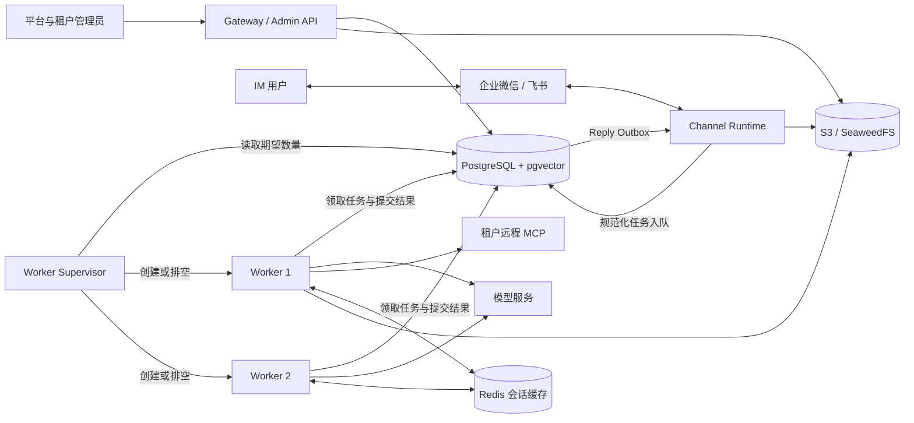

# 架构

核对日期：2026-10-07，代码基线 `89d213d`。消息收发与配置清理的详细步骤见[运行时序](运行时序.md)。

## 进程与职责

本地 `start.sh` 使用主机 Python 运行应用，Docker Compose 只启动数据库、对象存储和监控组件。

| 角色 | 本地进程 | 负责什么 |
| --- | --- | --- |
| Gateway | 1 个 API 进程 | `/admin`、`/tenant`、管理 API、健康检查和静态页面 |
| Channel Runtime | 1 个 channel 进程 | 两类 IM 长连接、入站规范化、处理中提示、Reply Outbox 投递 |
| Worker Supervisor | 1 个 supervisor 进程 | 读取 Worker Pool 期望数量，创建或排空 Worker 子进程 |
| Agent Worker | 默认首次启动 2 个进程 | 领取任务，执行模型和工具，提交会话与回复记录 |

企业微信和飞书长连接直接进入 Channel Runtime，不需要经过 Gateway HTTP 转发。Gateway 与 Channel Runtime 都通过共享数据库读取配置；不存在一个进程依靠内存直接把任务交给另一个进程的必经通道。

图中的连接表示依赖和数据读写。PostgreSQL 队列、Outbox 都由消费者轮询领取，不是数据库主动推送。

## Worker 与 slot

一个 Worker 是一个独立进程。进程启动时根据 `concurrency` 创建多个 `asyncio.Task`，每个 Task 运行一个 slot 循环：领取一个任务、执行、记录结果，再领取下一个任务。slot 不是线程，也不是独立 CPU 核心。

| 配置 | 可同时执行的业务任务数 | 进程故障范围 |
| --- | ---: | --- |
| 1 Worker × 1 slot | 1 | 当前 1 个执行槽 |
| 1 Worker × 2 slots | 2 | 同一进程内的 2 个执行槽 |
| 2 Workers × 1 slot | 2 | 故障进程内的 1 个执行槽 |

这个上限还受会话顺序、任务是否到期、预算和外部服务容量约束。同一 Session 的后续任务必须等待前面的未完成任务；不同 Session 可以并发。等待异步模型或数据库调用时，事件循环可以运行其他 slot。阻塞事件循环的代码仍会拖慢同进程的其他任务。

`TRPC_SERVICE_LOCAL_WORKER_NODES` 是本地首次初始化的节点数，之后以数据库中的 `desired_nodes` 为准。`TRPC_SERVICE_WORKER_CONCURRENCY_PER_NODE` 设置每个子进程的并发槽位。本机压测中 1×2 与 2×1 接近，说明增加槽位是该负载下吞吐增长的主要原因，不能将结果解释成进程数在所有负载下都线性加速。

## 消息如何经过系统

1. Channel Runtime 找到启用的 Binding 和可用 Agent，选择配置版本，建立 TenantContext。
2. Adapter 解析消息；媒体先经过下载和存储处理。身份服务把外部用户、群或线程映射到 Principal、Conversation、Session。
3. 将规范化请求幂等写入 `agent_task`。成功后调用逻辑 ACK，并尝试发送可见的处理中提示。
4. 空闲 slot 领取到期任务，同时取得任务租约 token。Pipeline 再建立 Inbox/Runner 执行状态和 Session fence，检查配置、权限与预算。
5. 读取 Session、Summary、Memory，装配当前 Agent 获准的工具。Session 缓存只有版本一致才使用，否则从 PostgreSQL 读取。
6. Runner 执行模型和工具调用。执行期间分别维护任务租约和 Session 执行租约。
7. 在数据库事务中提交会话事件、状态、Inbox/Runner 结果与回复 Outbox。Worker 随后将队列任务标记为完成。
8. Channel Runtime 内的 Delivery Worker 领取 Outbox，调用对应 IM 适配器发送，持久化回执与投递状态。

模型执行不持有贯穿整次网络调用的数据库事务。Usage Ledger、Tool Ledger、运行审计、Attempt/Checkpoint 各自使用短事务，不与最终 Session 提交合并成一笔外部调用事务。

## 为什么不需要固定路由到同一个 Worker

完整会话、配置快照和执行状态保存在 PostgreSQL。Redis 只保存带租户、Agent、Session 和版本的近期快照。任务可以由任意空闲 Worker 领取，同会话顺序由 SQL 候选筛选与租约保护。

任务领取使用 `FOR UPDATE SKIP LOCKED`，在同 Session 的未完成任务中只允许队首运行，再按创建时间竞争。这不是租户公平轮转：一个租户的长任务仍可能挤占另一个租户的处理时间。数据隔离不等于资源性能隔离。

## 工作目录属于一次执行尝试

执行目录 ID 由 `session_id + request_id + Session fencing_token` 序列化后哈希得到，放在租户和 Agent 目录下。目录内保留 `inputs`、`outputs`、`tmp`。

旧 Worker 被暂停时，即使仍持有旧目录文件锁，新接管者也会使用新 fence 对应的目录。恢复旧进程不会获得新目录的锁或写入位置；数据库另外校验 token，拒绝过期执行者提交。

临时目录不承担会话恢复。需要跨尝试或跨 Pod 保留的内容必须写入对象存储或数据库。Kubernetes Worker 使用 Pod 独立 `emptyDir`；挂载共享卷也不会让不同 fence 自动继承旧文件。

## 存储与监控

| 组件 | 当前用途 |
| --- | --- |
| PostgreSQL | 配置、身份、任务、租约、Session、Inbox/Outbox、审批、账本和审计 |
| pgvector | 知识 Chunk 向量，当前物理列为 1024 维 |
| Redis | 可丢失、可重建的近期 Session 缓存 |
| SeaweedFS S3 | 原始知识文档、IM 媒体和 Artifact 正文 |
| OTel / Prometheus / Tempo | 运行指标与 Trace |
| Alloy / Loki / Grafana | 结构化日志采集、查询及监控展示 |

知识库上传和替换由管理 API 同步执行。停用文档只改变检索可见状态，彻底删除则先提交 SQL 删除与 `management_deletion` 清理收据，再清理对象、向量等外部数据。外部清理失败后由管理员从删除记录重试，没有后台自动重试器。详见[配置停用与删除](配置停用与删除.md)。

系统没有运行通用 Memory、Audit、Knowledge Outbox 投影消费者。当前 Runner 会读取 Memory，但不会在每次对话后自动抽取长期记忆；聊天历史、会话摘要与长期记忆是不同的存储内容。

Kubernetes 使用相同应用角色，初始清单为 2 个 Gateway、2 个 Worker、1 个 Channel Runtime、1 个 Scaler。两种部署方式的进程数与故障域不同，详见[Kubernetes 部署](Kubernetes部署.md)。

`/health` 只表示 Gateway 进程存活。`/ready` 查询主数据库并返回活跃 Worker 数，当前即使该数量为 0 也可能返回 200；它不检查每个机器人是否认证，也不验证模型、MCP、Redis 或对象存储是否可用。业务验收还需完成一条实际请求。

## 代码入口

- [启动脚本](../start.sh)、[角色入口](../trpc_service/_cli.py)
- [Worker 与 slot](../trpc_service/agent/worker.py)、[任务队列](../trpc_service/agent/queue.py)
- [执行 Pipeline](../trpc_service/agent/pipeline.py)、[上下文与提交](../trpc_service/agent/runtime.py)
- [企业微信入站](../trpc_service/channels/wecom.py)、[飞书入站](../trpc_service/channels/feishu.py)
- [Outbox 投递](../trpc_service/channels/delivery.py)
