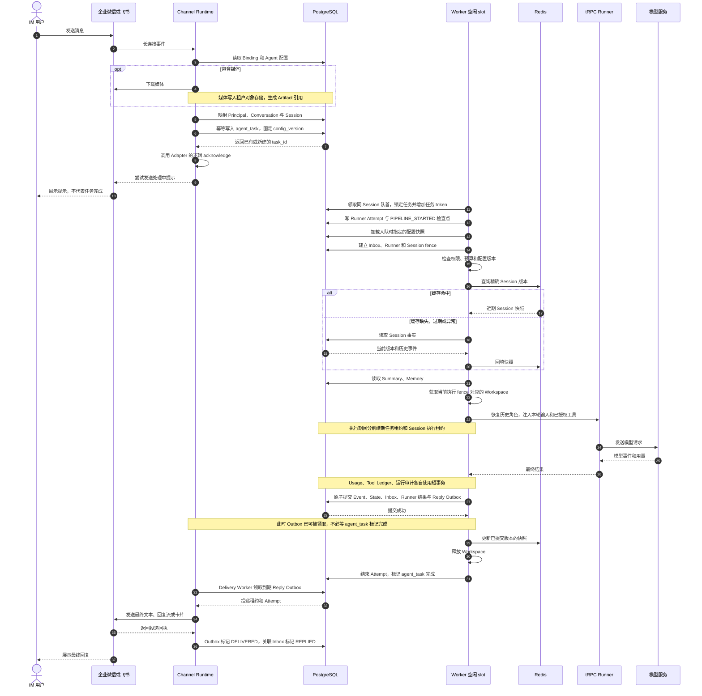
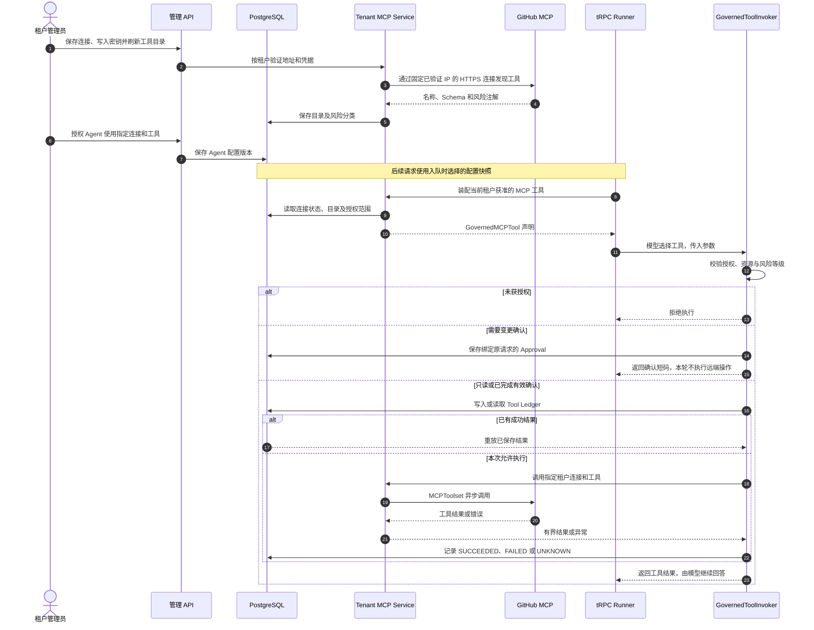
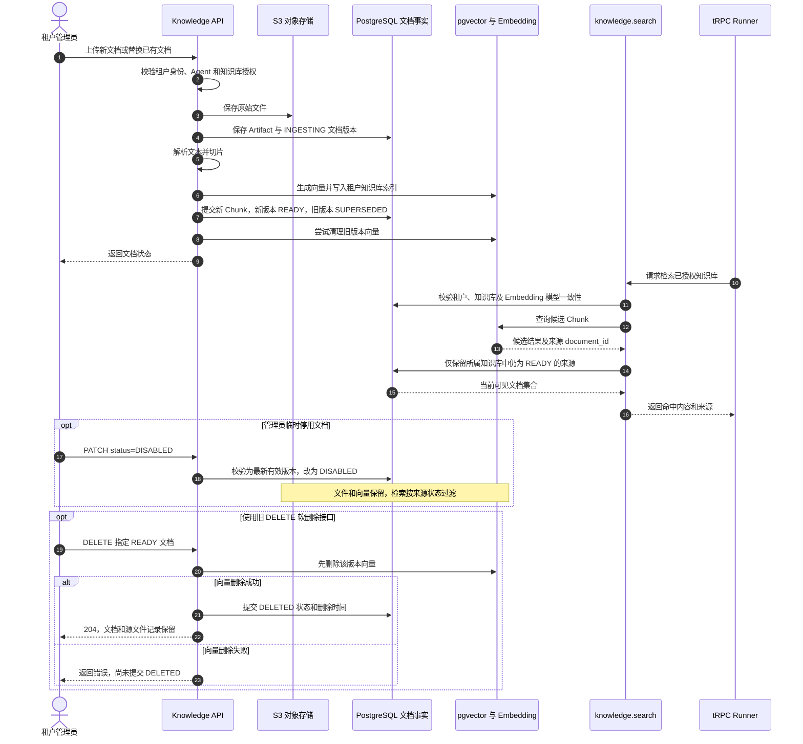
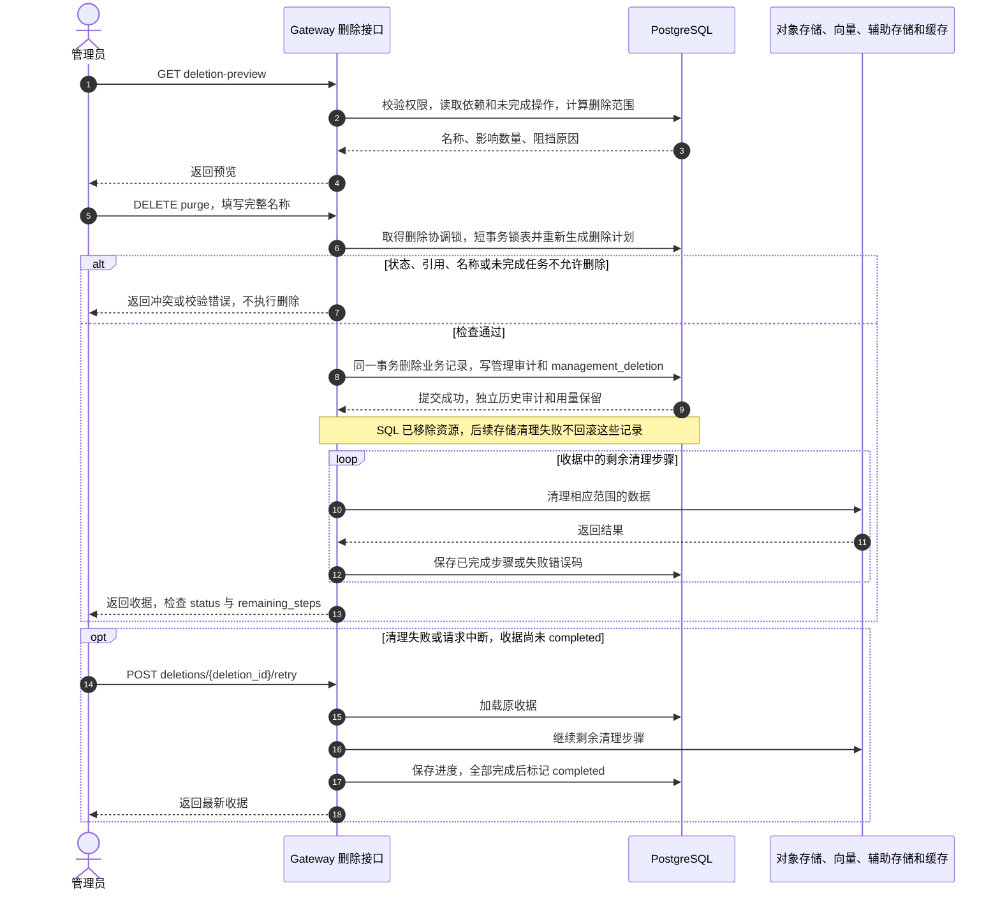
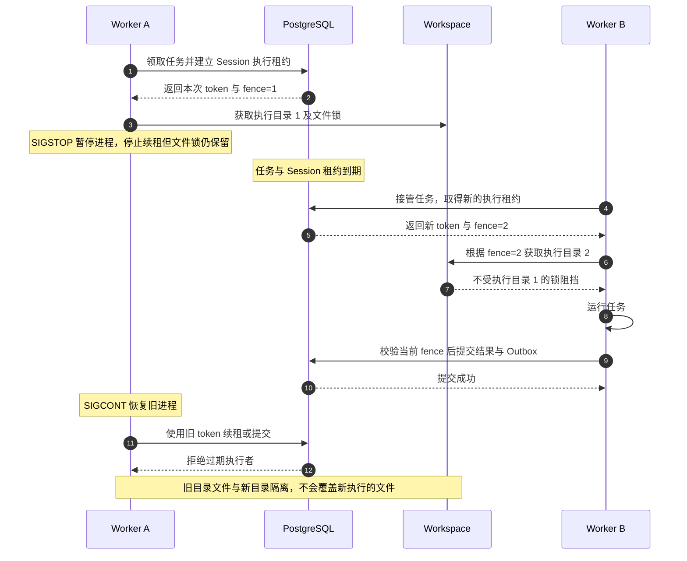
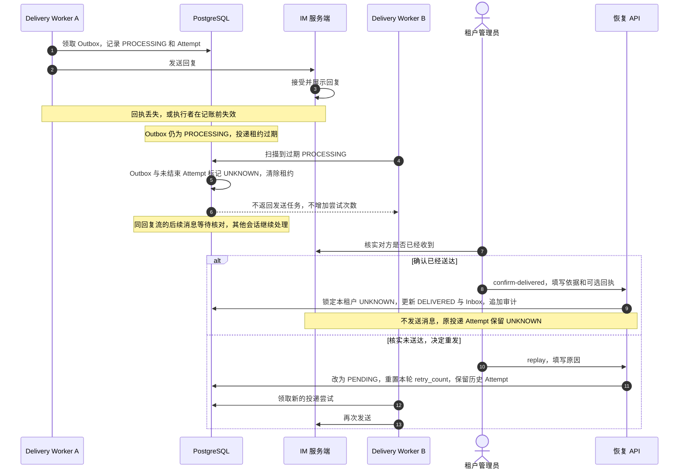

# 运行时序

核对日期：2026-10-07，代码基线 `89d213d`。图中“PostgreSQL”包括多个短事务，不表示模型、MCP 或 IM 调用期间一直持有数据库事务。企业微信与飞书通过长连接进入 Channel Runtime，不经过 Gateway HTTP。

本页包含普通消息、MCP、知识更新、彻底删除、Worker 接管和投递核对六条流程。需要逐表理解主键、去重与关联时，配合[存储表结构设计](存储表结构设计.md)阅读。

## 一条普通 IM 消息

处理中提示是尽力发送。提示发送失败不撤销已经持久化的任务。图中“逻辑 acknowledge”不是对每一种 SDK 底层确认帧的描述。

当前 Runner 先汇总执行结果并提交 Outbox，再进入 IM 发送。回复流或 CardKit 的分段展示，不等于把模型生成的每个 token 实时跨进程转发给 IM。媒体下载发生在入队前，也可能拉长首次提示时间。

代码：[企业微信入站](../trpc_service/channels/wecom.py)、[飞书入站](../trpc_service/channels/feishu.py)、[Pipeline](../trpc_service/agent/pipeline.py)、[结果提交](../trpc_service/agent/runtime.py)、[投递队列](../trpc_service/channels/delivery.py)。

## GitHub MCP 查询

前提：连接已启用、目录刷新成功、Agent 已授权具体工具。连接可用与 Agent 获得工具权限是两件事。

`readOnlyHint=true` 且未声明 `destructiveHint=true` 的已授权 MCP 工具按只读处理。其余工具保守要求确认；成功刷新目录本身不代表获得调用权限。结果不明的调用不会因为 Worker 重试而直接再次执行。

当前传输保留异步请求流，固定已校验 IP，同时保留 HTTPS Host 与 SNI，禁止跨 origin 和自动重定向。先前 GitHub 联调中修复的异步请求流问题位于这一层。仓库搜索工具还提供 `fork:true` 的查询提示，避免把默认排除 fork 的空结果误判成仓库不存在。

代码：[MCP 服务与工具装配](../trpc_service/mcp/service.py)、[MCP 传输](../trpc_service/mcp/transport.py)、[工具治理](../trpc_service/agent/governance.py)。

## 知识文档更新与检索

SQL 文档状态与向量、对象存储不是一笔跨系统事务。新向量写入失败会使摄取失败；新版本提交后清理旧向量失败，不把已成功的新版本改回失败。旧 DELETE 的执行顺序是“先向量、后状态”，中途失败时可能需要重试，不能声称删除请求一开始就保证文档不可见。

停用只允许最新的 READY/DISABLED 版本切换状态。旧 DELETE 留下的 DELETED 版本不能用启用开关恢复。控制台的“彻底删除”走下方独立流程，会移除同文件名的全部版本，不只处理选中的一个版本。

代码：[知识服务](../trpc_service/storage/knowledge.py)、[管理接口](../trpc_service/storage/knowledge_router.py)。

## 彻底删除配置并清理外部数据

以下以租户或文档等需要外部清理的资源为例。是否需要先停用、是否保留共享文件，由资源类型和实际引用决定；不是所有删除都会访问所有存储。

发生错误时当前清理循环停止，未完成步骤保留在收据中；重试会重新处理尚未确认完成的步骤。没有外部清理步骤的删除可以直接记录 completed。HTTP 200 不能单独证明全部文件已清除，应看收据状态。当前没有后台自动重试器。

收据未完成时，该租户的普通配置写入、知识摄取和新的 Agent 执行准备会被阻止。租户已删除后，其管理员可能也已失效，需要由平台管理员重试；重试不调用模型或重新投递回复。

代码：[删除接口](../trpc_service/admin/deletion_router.py)、[删除计划](../trpc_service/admin/deletion.py)、[清理步骤](../trpc_service/admin/deletion_cleanup.py)。操作说明见[配置停用与删除](配置停用与删除.md)。

## 暂停 Worker 后接管

任务租约 token 和 Session 执行 fence 分别维护。下图的 `fence=1/2` 表示两次 Session 执行的先后关系，不要求它们与任务 token 数值相同。

修复前两次执行复用同一请求目录，暂停的 A 持锁，接管者耗尽 5 次执行尝试后失败。修复后首次接管即成功，任务总尝试次数为 2。这里的“2 次”是尝试计数，不是恢复耗时。

若 Worker 在 Session 结果和 Outbox 提交后、队列完成标记前退出，新 Worker 会先发现已有执行结果，复用 Outbox 并结束任务，不重新运行模型。这个窗口已用真实 LLM 验证：2 次任务尝试、1 次模型 HTTP 调用、1 条回复记录。

代码：[任务租约](../trpc_service/agent/queue.py)、[执行目录 ID](../trpc_service/agent/pipeline.py)、[已完成结果恢复](../trpc_service/agent/runtime.py)。

## 对方已收到，但本地没有记下成功

这类投递不能按普通任务租约到期处理，否则会再次发送已经送达的消息。

不能确认时保持 `UNKNOWN`。管理员决定重发仍可能造成重复，平台没有伪造一个“服务商已确认”的回执。这个策略避免自动重复发送，不承诺所有故障下都能无人值守恢复。

代码：[过期投递处理](../trpc_service/channels/delivery.py)、[核对与重放接口](../trpc_service/channels/recovery_router.py)。测试条件和结果见[测试结果](测试结果.md)。
