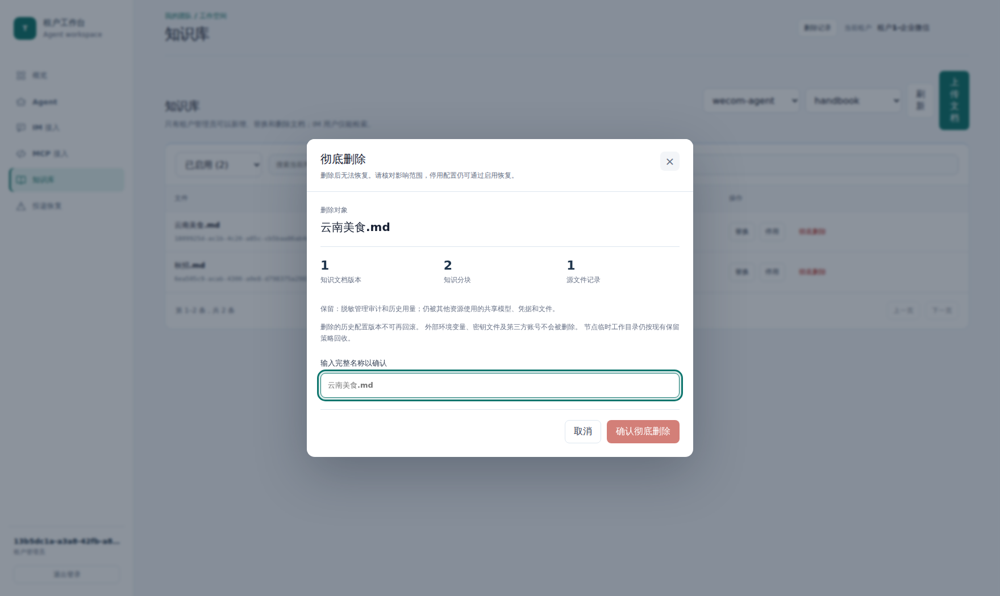

# 配置停用与删除

核对日期：2026-10-07，代码基线 `89d213d`。末尾验收数据来自 2026-09-30，没有在本次文档更新中重跑。

控制台现在区分“停用”和“彻底删除”。停用保留配置，可重新启用。彻底删除从数据库移除配置，释放原来的唯一名称或标识；操作不能撤销。

## 控制台操作

平台管理员可以删除租户、模型目录项、模型凭据、租户模型策略及符合条件的管理账号。租户管理员可以删除自己租户下的 Agent、IM 接入、MCP 连接和知识文档。平台提供的渠道适配器、工具和 Skill 实现不在删除范围内。

列表默认显示启用项，筛选器可以切换为停用项或全部。删除一般分三步：

1. 停用资源。知识文档不要求先停用；管理账号有独立的权限保护。
2. 点击“彻底删除”，查看影响数量和阻止删除的原因。
3. 输入完整名称，确认删除。

下图为 2026-10-13 从实际服务打开的文档删除预览，展示将删除的版本、分块与源文件数量；截图时没有提交删除。

模型或凭据仍被模型策略引用时，需要先更换或删除策略。策略、MCP 连接仍被 Agent 当前配置引用时，需要先调整 Agent；停用的 Agent 也会检查。当前稳定版本和灰度版本不能留下悬空引用。引用已解除的旧配置版本会随依赖资源删除，之后不能回滚到这些版本。

租户管理员账号随其所属租户一起清理。当前登录账号和最后一个平台管理员不能直接删除。一个账号如果还拥有其他租户或平台角色，删除租户时保留账号，仅清除被删租户的授权。

## 删除范围

| 对象 | 删除内容 | 保留内容 |
| --- | --- | --- |
| 租户 | 租户配置、Agent、机器人接入、租户密钥、模型策略、知识库、会话、记忆、任务与投递记录，以及所属文件、向量、缓存 | 全局模型和凭据、其他租户、独立审计与历史用量 |
| Agent | 配置版本、接入、会话、记忆、任务和投递记录 | 租户共享知识库和文件、模型策略、MCP 连接、独立审计与历史用量 |
| IM / MCP 接入 | 接入配置及其专属关联记录、不再被其他接入引用的租户密钥 | 仍被其他接入使用的密钥 |
| 知识文档 | 同一知识库下该文件名的全部版本、分块和向量；没有其他引用时删除源文件 | 其他文档、会话或任务仍在使用的文件 |
| 模型 / 凭据 / 策略 | 已解除引用的配置记录及相关旧版本 | 外部环境变量、密钥文件和供应商账号 |

知识文档停用后不再参与检索，重新启用不需要重新生成向量。旧接口已删除或被新版本替代的文档不能直接启用。彻底删除后可以重新上传相同内容。

知识文档的三条路径需要分开理解：

| 操作 | 接口行为 |
| --- | --- |
| PATCH status=DISABLED / READY | 只允许最新的 READY/DISABLED 版本切换，保留向量和源文件 |
| 旧文档 DELETE | 先删选中版本的向量，成功后提交 DELETED；不物理删除文档或源文件，向量删除失败时请求失败 |
| 资源 DELETE .../purge | 删除同知识库、同文件名的全部版本及分块，外部清理按收据继续；共享源文件仍可能保留 |

PATCH 和旧 DELETE 的完整路径为 `/api/v1/tenants/{tenant_id}/knowledge-bases/{knowledge_base_name}/documents/{document_id}`，需要查询参数 `agent_app_id`。彻底删除使用下方资源接口，不沿用旧文档 DELETE 的语义。

Worker 节点上的临时工作目录仍按现有保留策略回收，不由 Gateway 跨节点立即擦除。删除配置也不会删除运行日志、备份或外部供应商记录。

## 未完成任务与清理失败

排队、执行中、等待重试的任务，以及待投递、投递中、结果未知的回复，会阻止相关资源删除。待审批或结果不明的工具操作也需要先处理。不能用删除操作绕过 `UNKNOWN` 投递确认。

SQL 记录先在一个事务内删除，同时写入 `management_deletion` 清理记录。对象存储、向量、辅助记忆存储和缓存随后按步骤清理，每完成一步就保存进度。正常配置变更、文件摄取和删除操作通过数据库锁协调，避免清理期间重新写入同一范围。

删除预览只反映查询当时的状态，正式提交会重新检查。删除文档、MCP 连接和模型策略时，只要同租户还有未完成任务，也可能被阻挡，不仅检查是否看起来与该资源有关。当前 PostgreSQL 配置协调锁为全局锁，SQL 删除阶段还有表锁，大范围删除可能暂时影响其他配置写入；出现 409 应按实际原因处理。

文件服务不可用或请求中断时，配置可能已经移除，但清理记录仍显示未完成。控制台顶部的“删除记录”提供重试入口。重试不会重新发送消息，也不需要调用嵌入模型。租户删除后的清理由平台管理员重试。相关租户在清理完成前暂不允许继续配置写入或启动新的 Agent 执行。

当前重试由管理员触发，没有后台自动重试任务。清理记录最多显示 100 条，未完成项优先。不能仅依据 HTTP 200 判断外部清理成功，还应检查返回的 `status` 是否为 `completed`。

收据包含 `deletion_id`、`resource_type`、`resource_id`、`name`、`status`、`remaining_steps`、`error_code` 和 `created_at`。`pending` 表示还没完成，`failed` 表示某一步失败，`completed` 表示计划中的步骤全部完成。请求超时后先查收据；如果 SQL 已提交，应重试原收据的清理，而不是再次删除已经不存在的资源。

## 接口

以下路径均以 `/api/v1` 为前缀。

| 操作 | 方法与路径 |
| --- | --- |
| 平台资源删除预览 | `GET /admin/resources/{kind}/{id}/deletion-preview` |
| 平台资源彻底删除 | `DELETE /admin/resources/{kind}/{id}/purge` |
| 租户资源删除预览 | `GET /tenants/{tenant_id}/resources/{kind}/{id}/deletion-preview` |
| 租户资源彻底删除 | `DELETE /tenants/{tenant_id}/resources/{kind}/{id}/purge` |
| 平台清理记录与重试 | `GET /admin/deletions`、`POST /admin/deletions/{id}/retry` |
| 租户清理记录与重试 | `GET /tenants/{tenant_id}/deletions`、`POST /tenants/{tenant_id}/deletions/{id}/retry` |

平台资源类型为 `tenants`、`model-catalog`、`model-credentials`、`principals`。租户资源类型为 `agents`、`channel-bindings`、`mcp-connections`、`model-profiles`、`documents`。其中模型策略仍只允许平台管理员操作。

删除请求体：`{"confirmation": "资源完整名称"}`。预览返回影响数量和阻止原因；实际删除时再次检查权限、状态和依赖。名称不匹配返回 422，仍被引用或仍有未完成任务返回 409，不存在返回 404。

原有软删除接口保持原语义。新控制台通过 PATCH 更新启用状态，通过带 `/purge` 后缀的接口执行彻底删除，避免旧客户端无意触发物理删除。

数据库迁移 `20260930_0029` 新增清理记录表，将历史审计、用量和文件上传归属与可删除的 Agent 解耦，并增加文档 `DISABLED` 状态。迁移回退不能恢复已经删除的数据。

## 2026-09-30 验收记录

- 完整回归：496 项通过，包含 `dev/tests/test_resource_deletion.py` 中的 21 项专项测试。默认回归跳过的 2 项外部组件测试另行执行，均通过。
- Playwright 验证两个控制台的状态筛选、删除确认、引用保护、知识文档停用与恢复，以及手机布局。
- 已启动的真实 Worker 调用 `qwen3.7-flash`，返回 `17 × 23 = 391`，用量账本记录 158 tokens。回复在本地测试接收端核对，未向外部 IM 发送消息。
- 真实知识上传使用已配置的嵌入模型。删除测试租户后，SQL 业务记录和向量清空，对象存储文件由 1 个变为 0 个。原有 1 条用量及 2 条执行审计保留，测试账号及已有登录会话失效。
- 现有租户的 IM 接入配置在测试前后保持一致。

测试脚本、日志和截图保存在本机 `dev/deletion/`、`dev/deletion-browser/`，这些目录被 Git 忽略。

496 项包含 21 项删除专项，不应重复相加；另行执行的 2 项是原回归中跳过的外部存储测试。默认克隆只有 `tests/`，不包含本地专项脚本，也没有由这次验收得出的新覆盖率数值。完整统计范围见[测试结果](测试结果.md)。
